# Rat Run 🐀

A **bullet-hell horde survivor** for your terminal — *Vampire Survivors* rendered
in half-block "pixels" with 2D lighting, cast shadows, particles and a lot of
screen shake, running entirely in a text terminal. Built in Rust with
[`ratatui`](https://ratatui.rs) and `bevy_ecs`.

You are **Subject R-47**, a lab rat that chewed out of its cage. The facility's
extermination protocol is awake, and everything in it wants you back. You only
*move*; your weapons fire themselves. Claw up through the Sewers, the Kitchens
and the Lab core, or take the side routes through the Laundry and the
Printworks — and take a practice run on the back of a moving flatbed when you
want a different kind of floor.

## Screenshots

Every frame below is a real 120 × 40 terminal frame, dumped by the game's own
capture harness (`RATRUN_DUMP=<target> RATRUN_DUMP_DIR=<dir> cargo test
dump_frame_ppm`, see [`CLAUDE.md`](CLAUDE.md)) and rasterised cell for cell.

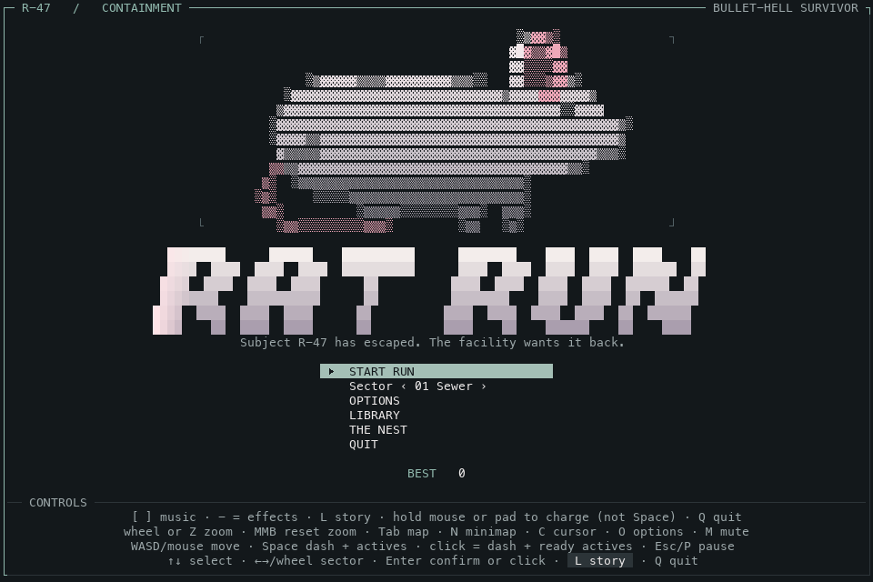

*The title plate: Subject R-47, the sector row and the controls legend.*

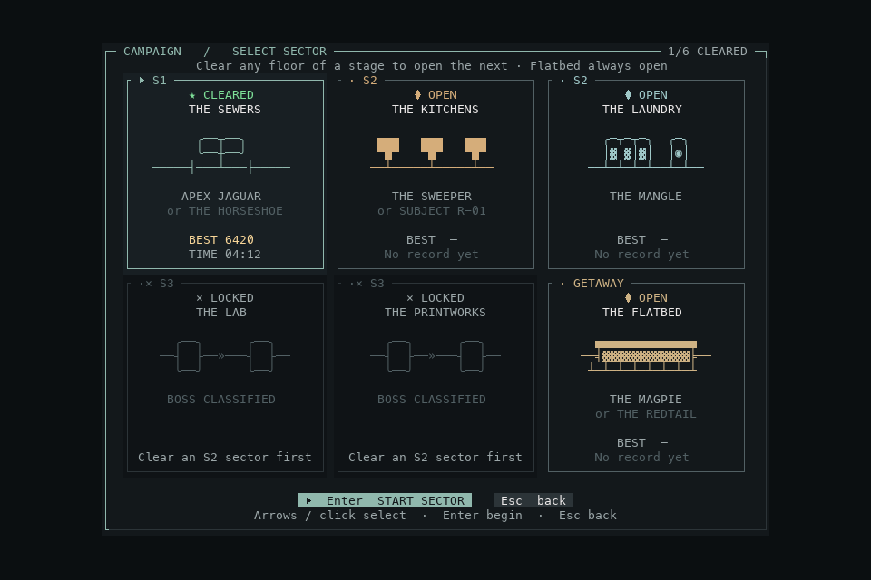

*Sector select: cleared, open and locked floors with their bests. A floor with
two possible bosses names both.*

| | |
| --- | --- |
| 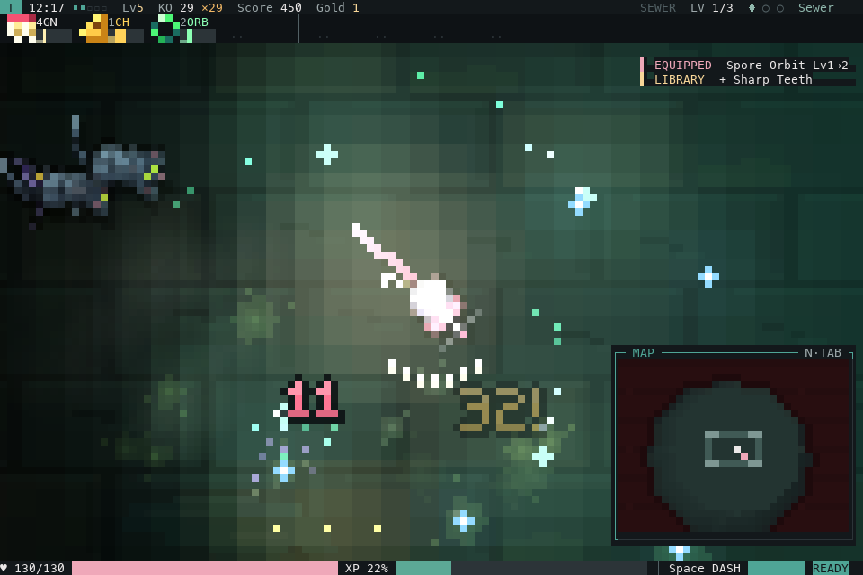 | 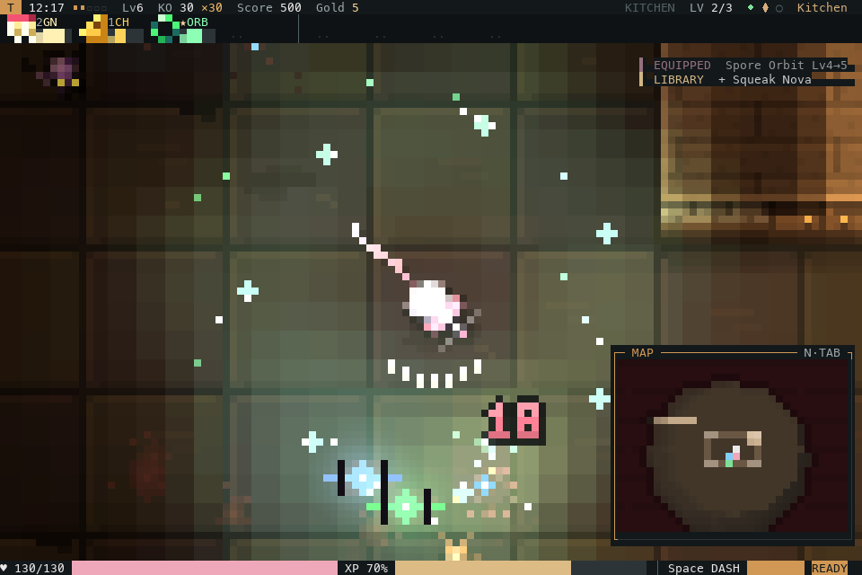 |
| *The Sewers: damp green masonry and the first horde.* | *The Kitchen: warm amber light over tile and counters.* |
| 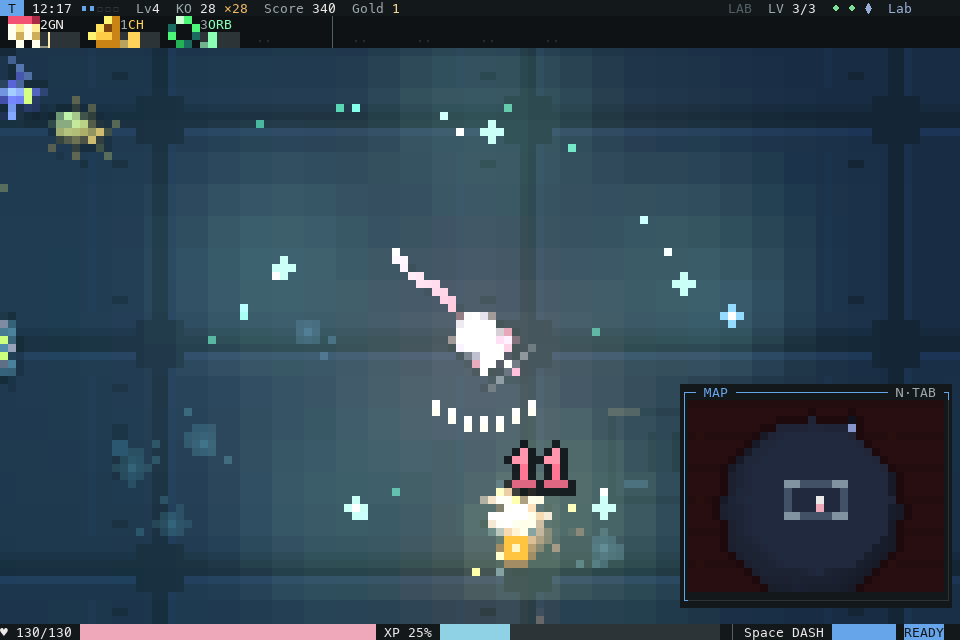 | 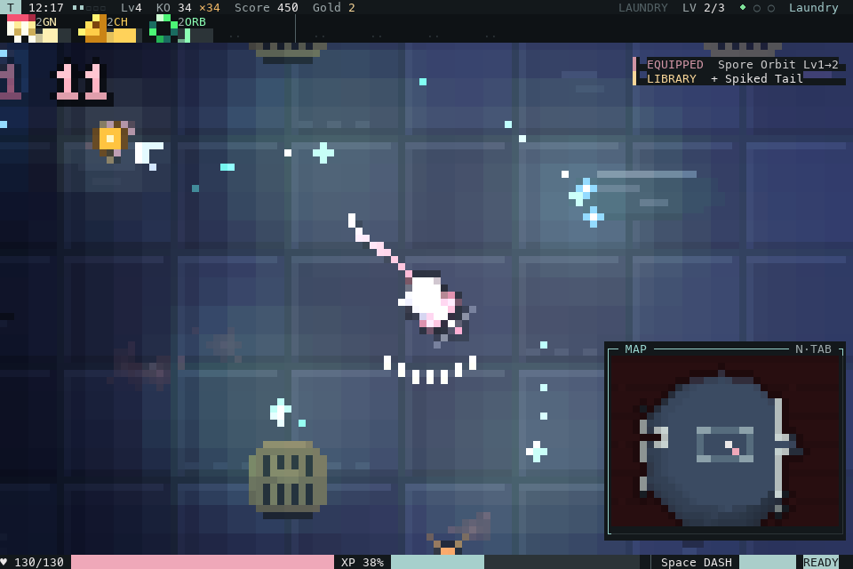 |
| *The Lab: cold clinical floor under hard-edged lamps.* | *The Laundry: washer aisles and a floor drain.* |
| 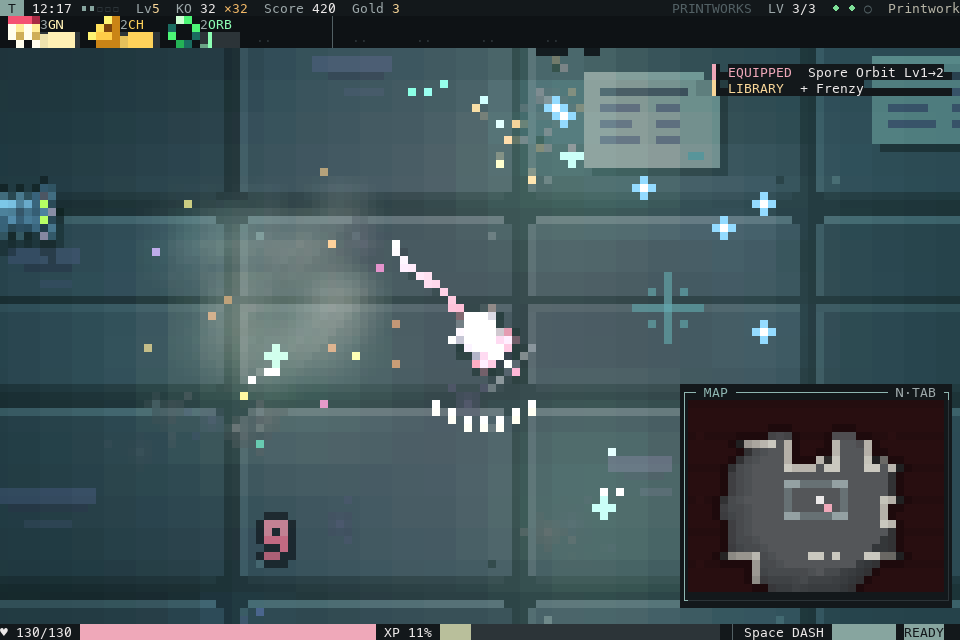 | 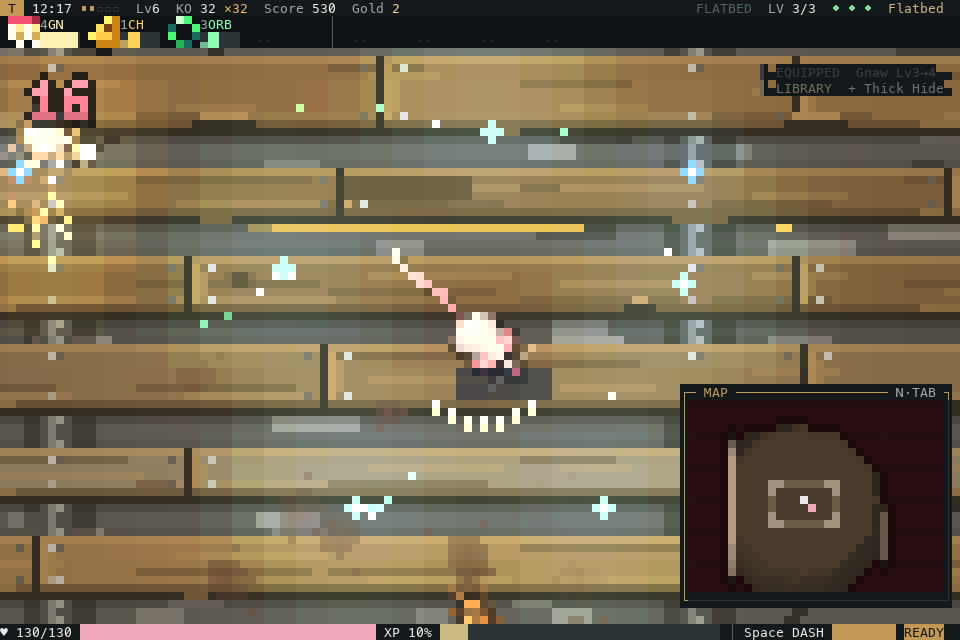 |
| *The Printworks: press islands and paper stacks.* | *The getaway ride: the flatbed's planks and rails.* |

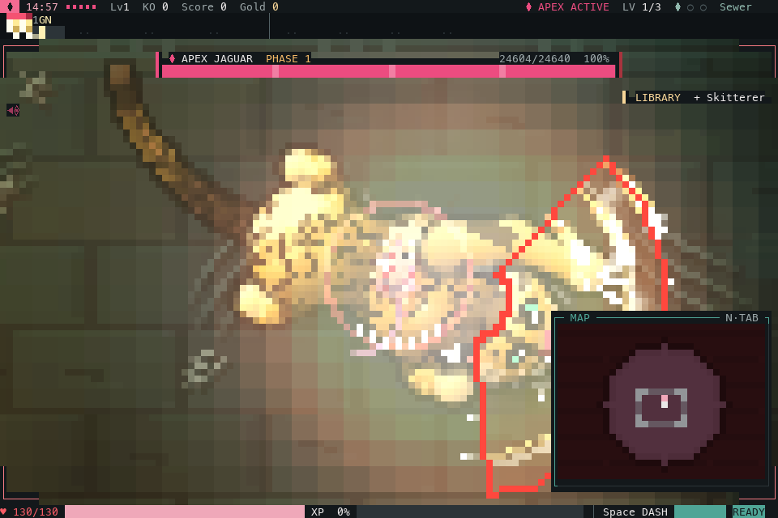

*A boss fight — here the Apex Jaguar — with the boss bar and a marked landing
(the red outline) before it bites.*

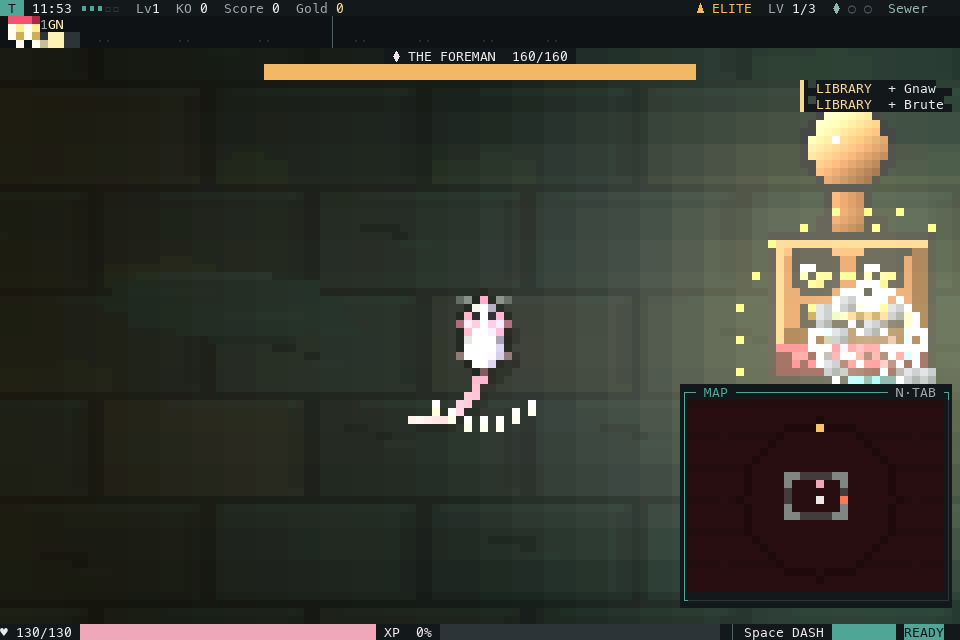

*A named miniboss, The Foreman, with its own health plate.*

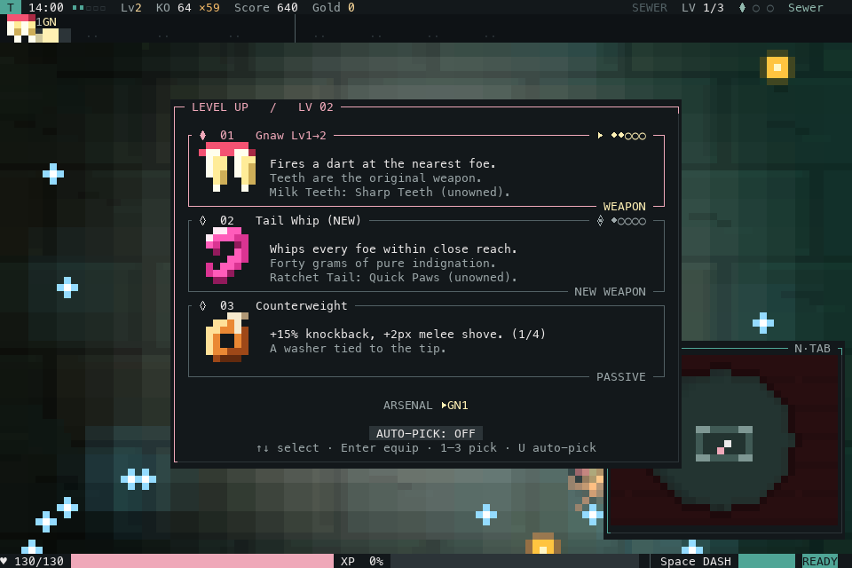

*A level-up: three cards, each with an icon, a stat line and a flavor line.*

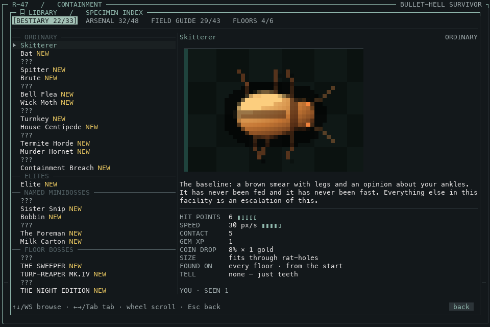

*The Library's BESTIARY tab: discovered entries beside locked ones.*

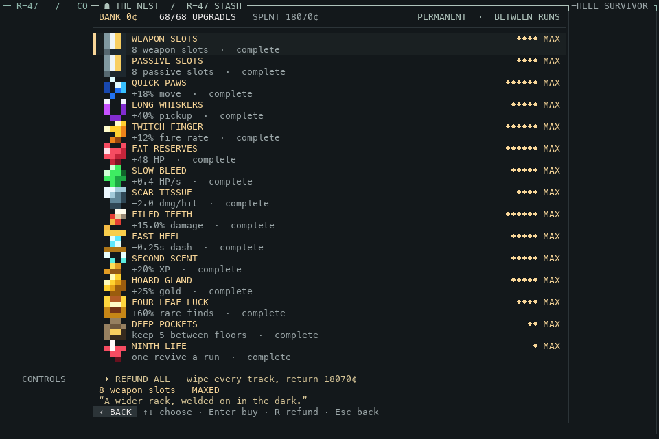

*The Nest: the permanent upgrade board (here fully bought).*

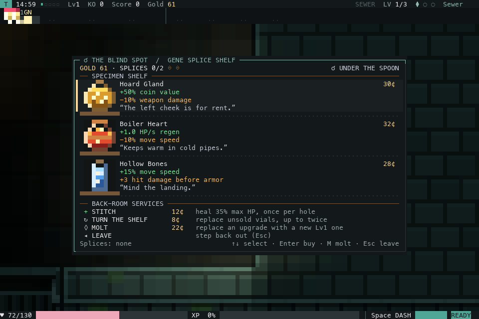

*The gene-splice shelf behind a mouse hole: three splices and the services.*

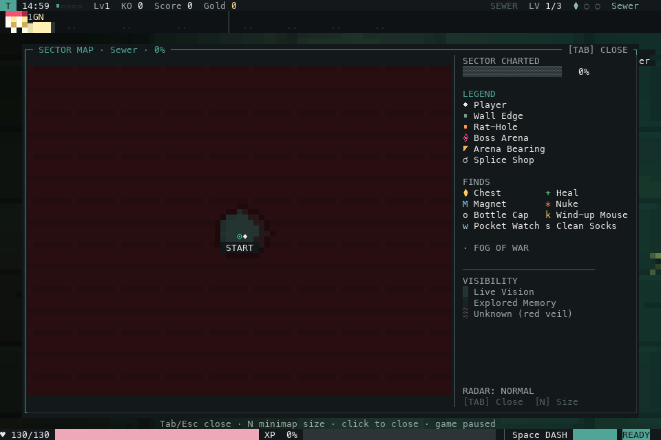

*The expanded `Tab` map a second into a run: the dark red veil is territory you
have never seen.*

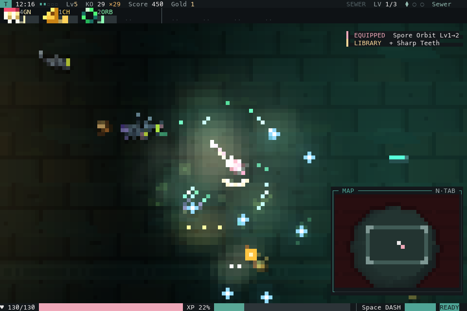

*Zoomed out to 2×: twice the world, with pellets and loot kept legible.*

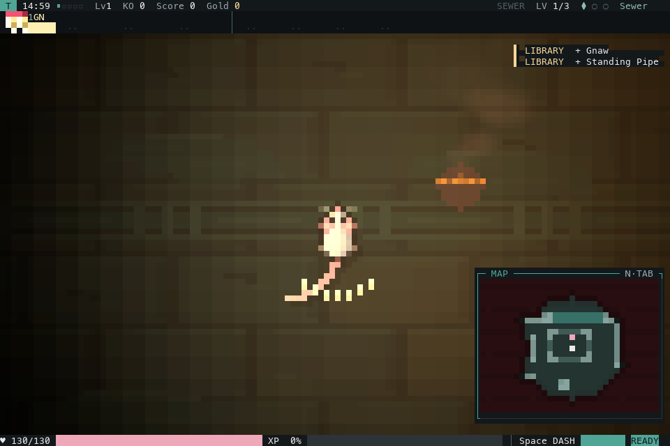

*A Sewer room lit by a brazier: the fixture's pool of light falls off into the
dark.*

## What is new

- **Every floor has its own cast.** 48 ordinary enemy kinds, eight to a floor
  and none shared between floors: the Sewer opens on Skitterers, the Laundry on
  Wool Pills. (The 33 newest are named, statted and in the Library;
  most still move like the body they are built on and get their own trick in a
  later update.)
- **24 named minibosses**, four per floor in a fixed order, each with one
  signature shape, a one-second tell and a chest on death.
- **Three more floors**: the Laundry and the Printworks as side routes with
  their own hazards and bosses, and the Flatbed, a practice ride with pits,
  sliding cargo and a slipstream.
- **Hold-to-charge Super Dash**, thirteen chest evolutions, the gene-splice shop
  behind the mouse holes, and the Nest's fifteen permanent tracks.
- **Remappable controls** for keyboard, mouse and gamepad (26 actions, three
  schemes), and a four-tab Library that fills in as you meet things.

## Features

- **You only move.** Eight-direction movement with a dash; every weapon fires,
  aims and reloads itself.
- **Four sectors on a route, with two side routes.** Sewer → Kitchen *or*
  Laundry → Lab *or* Printworks → the Flatbed, the getaway ride and the finale.
  Between sectors you pack up to three powerups and pick which floor the next
  sector plays. The Flatbed is also always open as a practice floor from sector
  select.
- **Every floor has its own roster**: eight enemy kinds that unlock on the
  clock, from the first fodder to a third trick at 9:45, and its own four
  minibosses — 48 ordinary kinds and 24 named minibosses across the six floors.
- **Fifteen minutes a floor**, escalating hordes, **four named minibosses** at
  3:00, 6:00, 9:00 and 12:00 (each leaves a chest), then **the floor's boss** at
  15:00. There is no arena to walk to: the boss comes to wherever you are. Ten bosses across the six floors; a floor draws its boss from its own
  pool.
- **13 weapons**, **12 passives**, and **13 evolutions** — a maxed weapon plus
  the right passive evolves into something else entirely when you open a chest.
  Level-ups are rare (about thirteen a floor) and every one adds 4% weapon
  damage. Each weapon has its own shape: Gnaw bites, the Tail Whip swipes the
  half-circle ahead, Squeak Nova is one expanding ring, Sonic Squeak a forward
  cone, Laser Eyes a sweeping beam, and the Spiked Tail cracks a real whip.
- **Gold, and two places to spend it.** Mouse holes in the walls hide a
  gene-splice shelf: two splice sockets, plus a heal, a reroll and a Molt
  service. Between runs, the **Nest** spends banked gold on 15 permanent tracks
  (more weapon and passive slots — 4 up to 8 each — speed, pickup range, HP,
  armor, luck, a revive, and more).
- **The Library**: a four-tab dossier that unlocks as you actually meet things —
  bestiary, arsenal, field guide and the floors themselves.
- **Procedural levels**: a 200 × 160 tile facility per seed with rooms, halls,
  corridors, wall rat-holes only you fit through, sometimes a maze with
  a cache and a one-way door, glue boards, baited mousetraps, steam grates and
  ink pads.
- **Fog of war** and a minimap with a compact radar, a small mode, or the full
  `Tab` map.
- **Terminal-native rendering**: half-block pixels, truecolor, 2D lighting with
  cast shadows and moving lights, smoke, particles, a screen-space ink pass for
  legibility, and a remappable control scheme for keyboard, mouse and gamepad.
- **Persistent** high scores, per-floor bests, preferences and your Nest.

## The floors

| Floor | Where it sits | Watch for | Boss pool |
| --- | --- | --- | --- |
| **The Sewers** | sector 1 | glue boards and baited mousetraps | The Jungle Cat, The Horseshoe |
| **The Kitchen** | sector 2 | glue boards and baited mousetraps | The Sweeper, SUBJECT R-01 |
| **The Laundry** | sector 2, side route | steam grates that warn, then plume | The Mangle |
| **The Lab** | sector 3 | glue boards and baited mousetraps | TURF-REAPER MK.IV, KING COBRA |
| **The Printworks** | sector 3, side route | ink pads that slow you while you stand in them | THE NIGHT EDITION |
| **The Flatbed** | practice only | pits in the bed, sliding cargo, the slipstream | The Magpie, The Redtail |

## Install

Tagged releases attach prebuilt binaries: a universal macOS build (a
double-clickable `Rat Run.app` that opens the game in Ghostty, iTerm2 or
Terminal, and the bare `ratrun` binary), Linux x86_64 and Windows x86_64. The
Linux binary needs the ALSA and udev runtime libraries (`libasound2`,
`libudev1`), which a desktop install already has.

To build from source, Rust is the only requirement. The repository pins its
toolchain in `rust-toolchain.toml` (currently `1.100.0`) — `rustup` fetches it
on demand, so no global change is needed.

```sh
git clone <this repo> && cd ratrun
cargo build --release
./target/release/ratrun
```

**Linux build notes**

- Audio goes through `cpal`/`rodio`, which link ALSA: install the dev headers,
  not just the runtime library —
  `sudo apt-get install libasound2-dev` (or your distro's equivalent).
- The default build includes gamepad support (`gilrs`), which links `libudev`:
  `sudo apt-get install libudev-dev`.
- To build on a machine without `libudev` (or without a console build), compile
  the gamepad feature out:

  ```sh
  cargo build --release --no-default-features
  ```

  `--no-default-features` also removes the admin console.

**macOS** needs nothing extra.

**Development**

```sh
cargo run --release      # play
cargo test               # the full suite (no TTY or audio device needed)
cargo clippy --all-targets
```

## Terminal requirements

Developed against **Ghostty**, which is the reference terminal: 24-bit colour,
the Kitty keyboard protocol, mouse reporting and the half block `▀`.

- **A real TTY** is required. The game sets raw mode and the alternate screen and
  restores both on exit (including after a panic).
- **Truecolor is strongly recommended.** Without it the game still plays: every
  colour is folded at the output edge into the xterm **256** palette (nearest
  cube/grey entry) or, on 16-colour terminals, the 16 named ANSI colours, and
  the lighting drops a detail tier with it. Layout, hit boxes and simulation
  state never change.
- **The Kitty keyboard protocol** ([kitty](https://sw.kovidgoyal.net/kitty/keyboard-protocol/),
  Ghostty, WezTerm, foot, recent xterm) buys two things: real key-**release**
  events, so held movement can never stick, and `report-all-keys`, which is the
  only way a **lone `Ctrl`** press reaches the game — and `Ctrl` is the dash key.
  On a terminal that cannot report it, `Space` dashes and fires the charged
  weapons together (the old mapping) and the in-game legends say which key is
  live. Startup waits at most 300 ms for the terminal's answer.
- **A font that draws geometric glyphs** is nice to have; on terminals whose font
  lacks them (Apple Terminal, the Linux console) or in a CJK locale, the game
  switches to a safe ASCII glyph set automatically. The half-block pixel canvas
  needs a terminal that treats ambiguous-width characters as single-width.
- **Mouse** support is optional but expected: the pointer aims or steers in some
  schemes, and menus are fully clickable.
- tmux works (colour defaults to 256 there); `TERM=dumb` does not (no cursor
  addressing). See [`TERMINALS.md`](TERMINALS.md) for the measured matrix.

## Controls

Three schemes, chosen on the **Options** screen and saved with the rest of your
preferences. Every binding is remappable on the **Controls** screen: pick a row,
press a key, pad button or mouse button, and a conflict swaps the two actions.
`R` (the Reset action, or the RESET DEFAULTS row) restores the active scheme's
defaults, and `X` / `Delete` / `Backspace` unbinds the selected row. The tables
below are the defaults; every legend in the game prints the live binding.

Movement, menus and preferences are the same in all three schemes:

| Key | Action |
| --- | --- |
| `W` `A` `S` `D` (arrow keys also move) | move |
| `Esc` (or `P`) | pause |
| `Tab` | expanded map (pauses the game) |
| `N` | minimap size |
| `Z` / `X`, mouse wheel | zoom in / out |
| middle click | reset the zoom |
| `C` | show/hide the cheese cursor |
| `M` | mute |
| `[` / `]` | music volume down / up |
| `-` / `=` | effects volume down / up |
| `O` | options |
| `G` | open or close Graphics during play or from pause |
| `S` (on Graphics) | cycle smoothing |
| `U` | toggle auto-pick level-ups |
| `L` | story crawl on the title, Library in a run |
| `Enter` | confirm · `Esc` or right click back in any menu |
| `B` | the Nest (from the pause screen, the incident report and the victory screen) |
| `Q` | quit from the title; back to the menu from pause and the end screens |
| `R` | refund every Nest track (on the Nest); reset the scheme (on Controls) |
| `1` `2` `3`, arrows + `Enter`, or a click | pick a level-up card |

Where the schemes differ:

| | Classic | Mouse aim | Gamepad |
| --- | --- | --- | --- |
| Aim | nearest enemy (auto). The pointer *steers* the rat | the pointer | right stick, when deflected |
| Move | `WASD` / arrows, or the pointer | `WASD` / arrows (eight directions) | left stick or d-pad (analog speed) |
| Dash | `Ctrl` (or left click; `Space` also dashes without lone-Ctrl reporting) | right click (or `Ctrl`) | `RB` |
| Fire charged actives | `Space` (or right click) | left click (or `Space`) | `X` |

**Super Dash** changes the dash: once you own that weapon, *hold* the dash input
to charge it (about 0.9 s to full, faster as it levels) and *release* to fire a
longer, wider, harder-hitting dash. A quick tap is still the ordinary dash, and
without the weapon the dash fires on the press as always. A key can only be held
on a terminal that reports key releases (the Kitty protocol); the mouse button
and the gamepad can always charge.

In **Classic** a left click is the dash (it also releases a charged active when
the dash goes off) and a right click fires the charged actives. The same right
click is **Back** in every menu, so it never opens one. In **Mouse aim** the
clicks split, so a left click never spends your dash.

The dash's cooldown has no read-out on the rat: the HUD's `DASH` module carries
it (and flashes when the dash is back). Holding the dash for a Super Dash does
draw a ring and a lane preview around the rat while it charges.

Gamepad defaults: d-pad/left stick move, right stick aims, `RB` dash, `X` fires
actives, `Start` pauses, `View` opens the map, `Y` toggles the cursor, `LB`
mutes, `RT`/`LT` zoom, `R3` resets the zoom and `L3` cycles the minimap. The pad
is only read while the terminal window has focus.

## Options

On the Options screen (title or pause): **music volume**, **effects volume**,
**minimap size** (normal / small / hidden), **cheese cursor** on/off, **mute**,
**zoom**, **auto-pick level-ups**, **control scheme**, entry to the **Controls**
screen, gamepad **dead zone** and **rumble**, and **wipe the nest** (two presses;
clears the bank and every permanent upgrade).

## Modes

Everyday play is `ratrun`. You can also watch and measure self-playing runs.

```sh
# A wall of self-playing games (default 16, max 32), each drawn for real.
ratrun --ai 16 [--seed N] [--skill expert|casual] [--level 1|2|3] [--once]
#   + / -  speed ladder     Space  pause    1..9 or click  zoom a game
#   Esc    unzoom           R      restart the wall      Q  quit

# Headless batches: N seeded runs, no terminal, no render, no audio.
ratrun --bot-batch 30 --seed 1000 --skill expert --json > batch.json
ratrun --bot-batch 20 --level 3 --practice --route printworks
ratrun --bot-compare before.json after.json
ratrun --bot-render batch.json
```

`--bot-batch` flags: `--seed`, `--level` (1–3, or 4 for the getaway ride),
`--practice`, `--carry none|typical`, `--route sewer|kitchen|lab|laundry|printworks|flatbed`,
`--skill expert|skilled|casual`, `--cycle-skills`, `--seed-exact`,
`--max-sim-seconds`, `--threads`, `--analyze`, `--json`, `--trace`,
`--caps W:P` (distinct-kind slot caps, e.g. `4:4` fresh or `8:8` maxed) and
`--meta none|mid|max` (the Nest stage a run is measured at). The report gives
win/clear rates with confidence intervals, where runs die, boss fight lengths,
damage taken by source and the build's boss DPS.

Terminal diagnostics: `ratrun --caps` prints what the game resolved about your
terminal and exits; `--probe` also prints the terminal's actual answer to the
keyboard-protocol query. `--color truecolor|256|16` and
`--glyphs unicode|safe` override detection.

### Testbed

Launch `ratrun --testbed [--floor sewer|kitchen|laundry|lab|printworks|flatbed]`
or enter `testbed [floor]` in the console. The default is Sewer. You start in
the sector's largest hall with god mode enabled. XP still counts, and the
testbed skips upgrade cards, scheduled encounters, scores, and banking.

| Keys | Action |
| --- | --- |
| `1` / `2`, `3` | Cycle rank-5 weapons and toggle evolution |
| `4` / `5`, `6` | Cycle pickups and drop one ahead |
| `7` / `8`, `9`, `0` | Cycle enemies, spawn five, or clear all enemies and bosses |
| `F1` / `F2`, `F3` | Cycle bosses and start the selected fight |
| `F5` / `F6`, `F7` | Cycle minibosses and spawn the selected one |
| `H`, `J`, `K` | Toggle god mode, toggle the horde, or kill visible enemies for loot |
| `T`, `F10` | Cycle sectors and toggle the testbed panel |

Custom bindings take priority. With default bindings, `P` pauses and
`Esc` or `Q` returns to the title from the playfield.

## Environment variables

| variable | effect |
| --- | --- |
| `RATRUN_DATA_DIR` | where `scores.json` lives (scores, bests, preferences, bindings, the Nest and the Library). Defaults to the platform data dir + `ratrun`. |
| `RATRUN_COLOR` | force the colour depth: `truecolor`, `256` or `16`. |
| `RATRUN_GLYPHS` | force the glyph set: `unicode` or `safe`. |
| `RATRUN_CONSOLE` | `RATRUN_CONSOLE=0` disables the admin console in a build that has it. |
| `RATRUN_CURSOR` | force the cheese cursor on/off for the session. |
| `RATRUN_MUSIC` | `chip` plays the floor songs on the old chip oscillators, `classic` the original chiptune; the default is the 16-bit palette. |
| `RATRUN_SMOOTH` | Edge treatment at 1× zoom: `0` (default) plain half blocks, `1` corner smoothing, `2` antialiasing, `3` xBR, `4` antialiasing with wedge glyphs, `5` xBR in exact colours. |
| `RATRUN_FOREGROUND` | `1` draws the overhead parallax layer (pipes, lines, hanging things). Defaults to Off. |
| `RATRUN_MUSIC_VOLUME`, `RATRUN_SFX_VOLUME` | pin a volume (0–100, `%` optional) for the session without writing it to your preferences. |

(Development-only switches — the screenshot dumper and the capture harnesses —
are documented in [`CLAUDE.md`](CLAUDE.md) and [`TERMINALS.md`](TERMINALS.md).)

## Credits

Design, code and procedural audio by the Rat Run contributors. Terminal
behaviour verified against Ghostty, Kitty, WezTerm, iTerm2, Apple Terminal, tmux
and the Linux console — see [`TERMINALS.md`](TERMINALS.md).

## License

MIT
