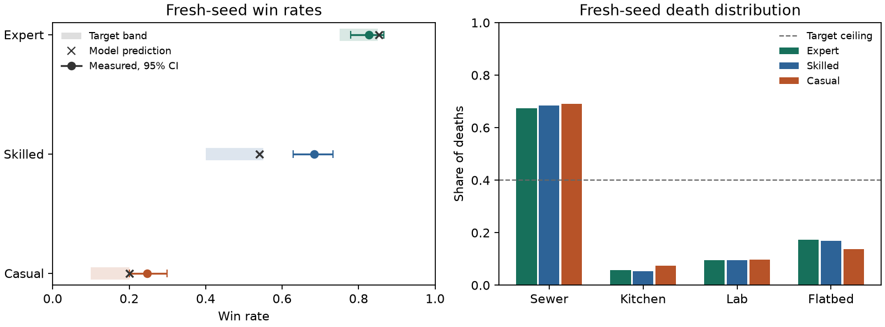
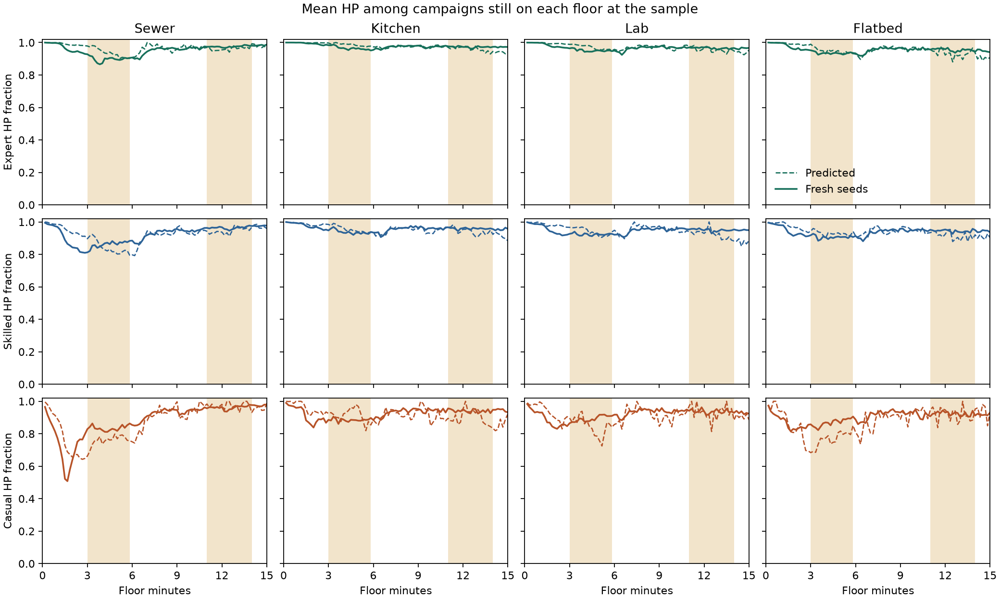
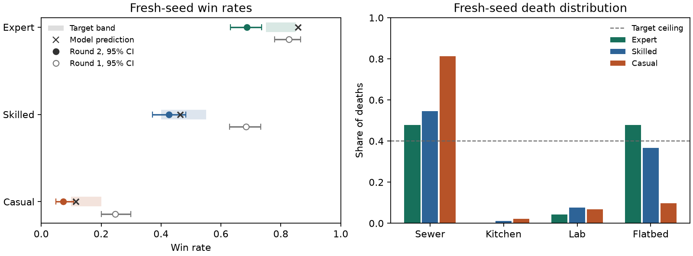
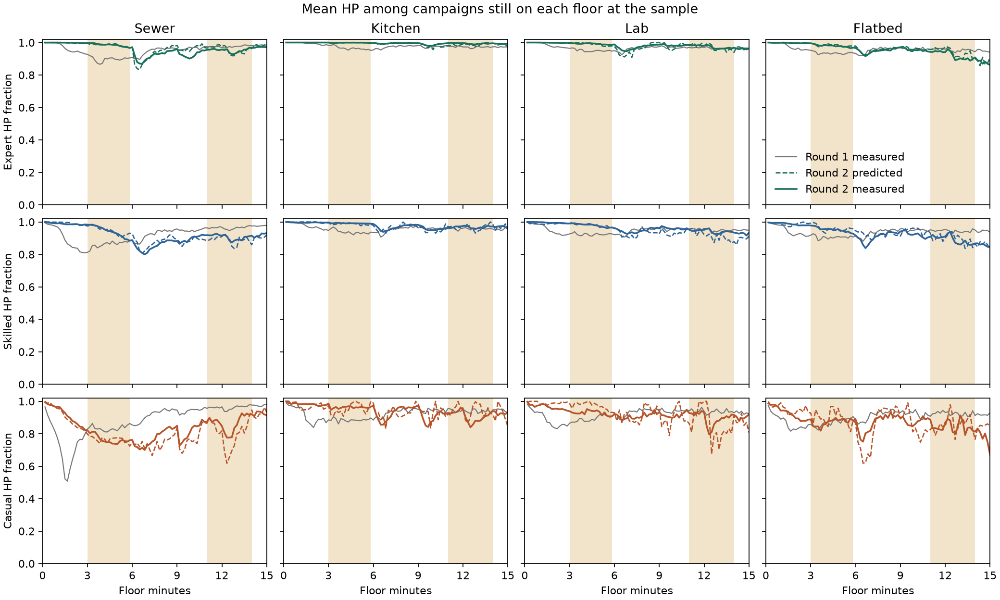
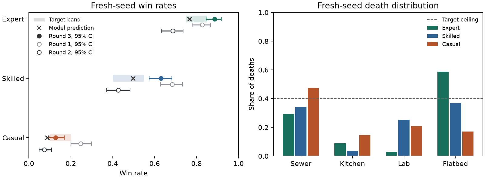
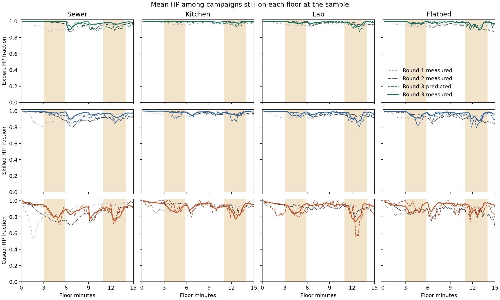
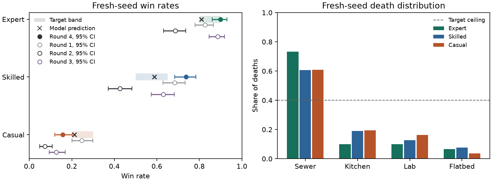
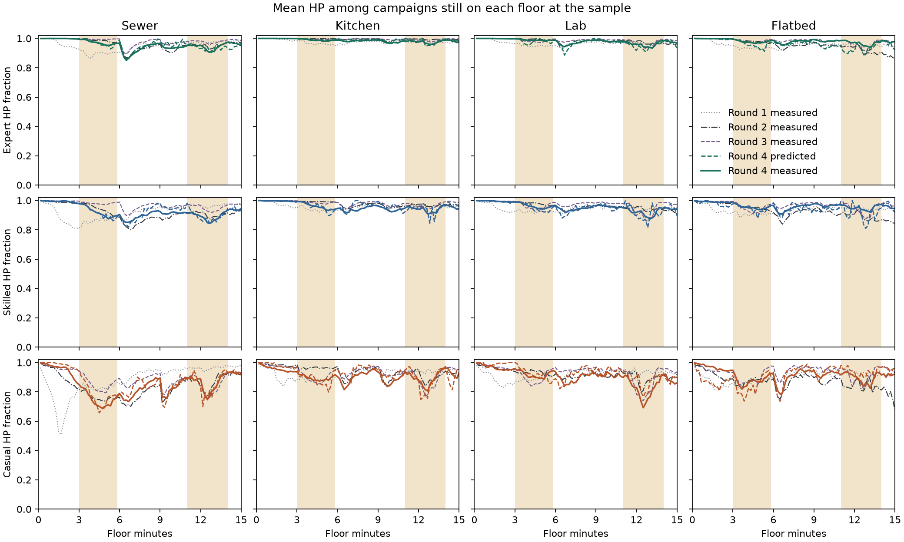

# Campaign Balance Record

This directory records the balance studies, model parameters, confirmation data, and testing protocol for Rat Run across `v0.4.0` through `v0.4.2` and the post-`v0.4.2` fresh-sector campaign restructure.

## Contents

1. [Files in this directory](#files-in-this-directory)
2. [How to test a tweak](#how-to-test-a-tweak)
3. [Targets and their history](#targets-and-their-history)
4. [Cross-study summary](#cross-study-summary)
5. [Hand tuning sweep (`v0.4.0`–`v0.4.1`)](#hand-tuning-sweep-v040v041)
6. [Modal Round 1 — broad global multipliers (`v0.4.1`)](#modal-round-1--broad-global-multipliers-v041)
7. [Modal Round 2 — feel-bounded sector and boss hazard knobs (`v0.4.2` pre-release)](#modal-round-2--feel-bounded-sector-and-boss-hazard-knobs-v042-pre-release)
8. [Modal Round 3 — director pressure beats and surges (shipped `v0.4.2`)](#modal-round-3--director-pressure-beats-and-surges-shipped-v042)
9. [Owner experiment — half player HP and 2× enemy HP (`v0.4.2`)](#owner-experiment--half-player-hp-and-2-enemy-hp-v042)
10. [No-carry restructure — fresh starts per sector and Head Start (`main`)](#no-carry-restructure--fresh-starts-per-sector-and-head-start-main)
11. [Modal Round 4 — adaptive horde power scaling and owner playtest](#modal-round-4--adaptive-horde-power-scaling-and-owner-playtest)
12. [Durable conclusions](#durable-conclusions)

---

## Files in this directory

| File | Description |
| --- | --- |
| [`tune-loop.toml`](tune-loop.toml) | Best overlay from the 12-trial hand tuning sweep (`+3` armor and redistributed sector contact ramps). |
| [`round1.toml`](round1.toml) | Modal Round 1 candidate overlay (16 broad global multipliers on `v0.4.1`). |
| [`round2.toml`](round2.toml) | Modal Round 2 candidate overlay (31 feel-bounded sector and boss hazard knobs). |
| [`round3-surges.toml`](round3-surges.toml) | Modal Round 3 candidate overlay (46 knobs with director surges; adopted as the built-in `v0.4.2` defaults). |
| [`half-hp-double-enemy.toml`](half-hp-double-enemy.toml) | Owner calibration overlay on `v0.4.2` (`player.max_hp = 79.477`, `enemies.hp_mult = 2.0`). |
| [`round4-fitted.toml`](round4-fitted.toml) | Modal Round 4 carried-campaign candidate overlay (51 knobs including `power_scaling`; requires the `power-scaling` branch schema). |
| [`round4-playtest.toml`](round4-playtest.toml) | Owner-anchored fresh-sector playtest overlay (`carry = false`, half player HP on Sewer, eased sectors 2–4, `power_scaling` on; requires the `power-scaling` branch schema). |
| [`round4-carried-playtest.toml`](round4-carried-playtest.toml) | Earlier carried-build version of the owner-anchored power-scaling playtest overlay (`carry = true`). |
| [`round1-confirmation.json`](round1-confirmation.json) | Verbatim Round 1 fresh-seed predictions, observed means/counts, and Wilson 95% intervals (`seeds 5000–5299`). |
| [`round2-confirmation.json`](round2-confirmation.json) | Verbatim Round 2 fresh-seed confirmation data (`seeds 6000–6299`). |
| [`round3-confirmation.json`](round3-confirmation.json) | Verbatim Round 3 fresh-seed confirmation data (`seeds 7000–7299`). |
| [`round4-confirmation.json`](round4-confirmation.json) | Trimmed Round 4 confirmation data (`seeds 8000–8299`). Retains `source_revision`, `screen_source_revision`, `predicted`, `observed_mean_and_count`, `skill_win_wilson95`, `measured_weighted_loss`, and `floor_clear_counts`; drops `observed_profiles` (594 KB of multi-cohort per-10-second sample arrays). |
| [`round1-sensitivity.csv`](round1-sensitivity.csv) | Compact Round 1 sensitivity table (all summary outcomes per knob; drops the 360 per-10-second `hp_<floor>_<sec>` rows). |
| [`round2-sensitivity.csv`](round2-sensitivity.csv) | Compact Round 2 sensitivity table (same filter). |
| [`round3-sensitivity.csv`](round3-sensitivity.csv) | Compact Round 3 sensitivity table (same filter). |
| [`round4-sensitivity.csv`](round4-sensitivity.csv) | Compact Round 4 sensitivity table (same filter). |
| [`img/`](img/) | Fresh-seed win/death (`round*-targets.png`) and survivor HP-curve (`round*-health.png`) plots for Rounds 1–4. |

The un-trimmed `sensitivity.csv` files (`1.25–4.91 MB` each, containing the 360 per-10-second `hp_<floor>_<sec>` curve derivatives per knob), the full `model4/confirmation.json` (`828 KB`), fitted `solution.json` artifacts, screening manifests, and `raw/` shard JSON receipts live in the untracked `/Users/joe/dev/ratrun/.review/model*/`, `.review/tuning/`, and `.review/nocarry/` directories on the owner's machine.

---

## How to test a tweak

When testing a balance tweak proposed by the owner, use sparse TOML overlays and small headless bot batches at maximum CPU speed rather than large response-surface sweeps.

### Standing protocol (5 runs per skill)

1. Write the proposed change as a sparse overlay in `docs/balance/experiments/<name>.toml` containing only the modified keys. Unspecified keys inherit the shipped defaults (see [`../../TUNING.md`](../../TUNING.md)).
2. Run 5 headless campaigns at each bot skill (`casual`, `skilled`, `expert` = 15 campaigns) with a fresh Nest (`--meta none`), plus the matching 15-campaign baseline on the same seed without `--tuning`:

```sh
for skill in casual skilled expert; do
  ratrun --bot-batch 5 --skill "$skill" --meta none --threads 8 --seed 1000 --json \
    > "/tmp/base-${skill}.json"
  ratrun --bot-batch 5 --skill "$skill" --meta none --threads 8 --seed 1000 \
    --tuning "docs/balance/experiments/<name>.toml" --json \
    > "/tmp/tweak-${skill}.json"
  ratrun --bot-compare "/tmp/base-${skill}.json" "/tmp/tweak-${skill}.json"
done
```

3. Report per-skill wins, deaths by floor and cause, boss fight durations, and the paired deltas against baseline.

### Execution and statistical rules

- **Headless and at maximum speed.** `--bot-batch` constructs no terminal, runs no pixel rendering, lighting, or sub-cell passes, opens no audio device, and steps ECS worlds as fast as `--threads` CPU cores allow. Never use `ratrun --ai` (the spectator wall) for balance measurements: `--ai` runs full `World::draw` frame rendering and frame pacing.
- **What 5 runs can and cannot tell.** Five Bernoulli trials carry very wide 95% Wilson intervals: `0/5` spans `0.0%–43.4%`, `1/5` spans `3.6%–62.4%`, `2/5` spans `11.8%–76.9%`, `3/5` spans `23.1%–88.2%`, `4/5` spans `37.6%–96.4%`, and `5/5` spans `56.6%–100.0%`. A 15-campaign check is a directional smoke test that catches broken scaling, stalls, or total wipeouts.
- **Human playtest is the judge.** Calibration against [`half-hp-double-enemy.toml`](half-hp-double-enemy.toml) showed that on Sector 1 the owner plays substantially better than even the Expert bot. Use the bot ladder to verify direction and cross-floor side effects, then hand the overlay to the owner for playtest judgment.
- **Subtle tweaks use 24 runs per skill.** When measuring a modest change (under ~15 percentage points on win rate, or a shift in per-floor death share), run `--bot-batch 24` per skill (`72` campaigns total), where a `50%` outcome narrows to a `31.4%–68.6%` Wilson 95% interval.

### Large Modal studies (only on explicit request)

Run a full Modal response-surface study only when the owner asks for one. The pipeline lives in [`../../tools/modal/`](../../tools/modal/README.md):

- `design.py`: reads a `--tuning-dump` TOML and writes `pilot-manifest.json`, `screen-manifest.json` (low-discrepancy Latin hypercube over `KNOBS`, 8 common seeds per skill), or `confirm-manifest.json` (`300` fresh exact seeds per skill).
- `app.py`: builds a CPU-only Debian + Rust `1.100.0` container on Modal, runs bounded 8-campaign `--bot-batch` shards with a `7,200 s` simulation cap, and writes checksummed `.receipt` files as shards finish so interrupted runs can resume.
- `verify.py`: runs one pilot shard locally and proves canonical JSON byte-identity between macOS and Modal Linux after stripping `tuning.path`, `wall_seconds`, and `sim_per_wall_second_per_thread`. `study.py` refuses to fan out until `determinism.json` records `bytes_equal: true`.
- `study.py`: projects list-price USD and two-attempt timeout ceiling from pilot timings, enforces `--max-compute-usd`, dispatches screening, fits the surrogate, dispatches fresh-seed confirmation, and writes the report.
- `fit.py`: excludes any screening point that stalled at the `7,200 s` cap, withholds 20% of whole settings as a holdout, fits 4-fold cross-validated logistic/multinomial models (wins, close calls, boss clears, floor/window death shares) and sample-weighted ridge regressions (timings, HP phases, card counts), and solves the bounded multi-objective loss with `scipy.optimize.differential_evolution`.
- `report.py`: verifies shard SHA-256 receipts and seed sets, writes `recommended.toml`, `confirmation.json`, `sensitivity.csv`, `report.md`, and `targets.png` / `health.png` / `holdout.png`. Pass `--baseline docs/balance/round1-confirmation.json` (in round order) to overlay prior rounds.

---

## Targets and their history

All studies evaluate full 4-sector campaigns on the default route (`Sewer → Kitchen → Lab → Flatbed`) starting with an empty Nest (`--meta none`), unless a route or Nest condition is explicitly noted.

| Dimension | Weight | Initial target (Sweep, Rounds 1–3) | Updated fresh-profile target (Round 4) | Metric definition |
| --- | ---: | --- | --- | --- |
| Expert win rate | 35% (shared) | `75%–85%` | `80%–90%` | Point estimate of campaign victories (`--skill expert --meta none`). |
| Skilled win rate | 35% (shared) | `40%–55%` | `50%–65%` | Point estimate of campaign victories (`--skill skilled --meta none`). |
| Casual win rate | 35% (shared) | `10%–20%` | `20%–30%` | Point estimate of campaign victories (`--skill casual --meta none`). |
| Death spread (floor) | 20% (shared) | `5%–40%` per floor | `5%–40%` per floor | Share of total campaign deaths occurring on each sector. |
| Death spread (clock) | 20% (shared) | `<= 40%` per 3-min window | `<= 40%` per 3-min window | Share of campaign deaths in any 3-minute floor-clock bin (`0:00–3:00`, `3:00–6:00`, …). |
| HP tension shape | 20% | Dip `>= 5 pp`, recover `>= 5 pp`, dip `>= 5 pp` | Same | Across `1:00–3:00 → 3:00–6:00 → 6:00–11:00 → 11:00–14:00` on all 12 skill-floor pairs. |
| Level-up pace | 10% | First card `15–21 s`; `13–17` cards by `15:00` | Same | Floor-entry clock to card 1; total cards drafted among runs reaching `15:00`. |
| Boss fights | 10% | `40–80 s` cleared mean; Casual clear `>= 5%` | Same | Mean fight duration on defeated bosses (named boss if `n >= 12`, else floor mean); Casual clears per encounter. |
| Close calls | 5% | `>= 55%` of wins dip `< 30%` HP | Same | Fraction of winning campaigns with `dropped_below_30_percent_hp == true`. |

---

## Cross-study summary

| Study / Profile | Sim / Ship Rev | Seeds (`n`/skill) | Expert wins (95% CI) | Skilled wins (95% CI) | Casual wins (95% CI) | Sewer death share (E / S / C) | Modal spend | Status |
| --- | --- | --- | --- | --- | --- | --- | ---: | --- |
| `v0.4.0` stock baseline | `c81a4a5` | `1000` (`24`) | `75.0%` (`55.1–88.0%`) | `45.8%` (`27.9–64.9%`) | `8.3%` (`2.3–25.8%`) | `33.3% / 61.5% / 72.7%` | `$0` | Baseline |
| Hand tune loop (`iter-11`) | `815a4ee` (`v0.4.1`) | `1000` (`24`) | `75.0%` (`55.1–88.0%`) | `54.2%` (`35.1–72.1%`) | `16.7%` (`6.7–35.9%`) | `16.7% / 45.5% / 55.0%` | `$0` | Provisional overlay ([`tune-loop.toml`](tune-loop.toml)) |
| Hand tune loop (`iter-11` holdout) | `815a4ee` (`v0.4.1`) | `2000` (`24`) | `87.5%` (`69.0–95.7%`) | `54.2%` (`35.1–72.1%`) | `8.3%` (`2.3–25.8%`) | `100% / 54.5% / 72.7%` | `$0` | Holdout check |
| Modal Round 1 | `2c67d6d` / `2f99d9c` | `5000–5299` (`300`) | `82.7%` (`78.0–86.5%`) | `68.3%` (`62.9–73.3%`) | `24.7%` (`20.1–29.8%`) | `67.3% / 68.4% / 69.0%` | `$1.75` | Candidate only ([`round1.toml`](round1.toml)) |
| Modal Round 2 | `ee60666` / `73c8675` | `6000–6299` (`300`) | `68.7%` (`63.2–73.7%`) | `42.7%` (`37.2–48.3%`) | `7.3%` (`4.9–10.9%`) | `47.9% / 54.7% / 81.3%` | `$1.30` | Candidate only ([`round2.toml`](round2.toml)) |
| Modal Round 3 (surges) | `90c1ba0` / `2b44aa1` | `7000–7299` (`300`) | `88.7%` (`84.6–91.8%`) | `63.0%` (`57.4–68.3%`) | `12.7%` (`9.4–16.9%`) | `29.4% / 34.2% / 47.3%` | `$1.20` | **Shipped as `v0.4.2` defaults** ([`round3-surges.toml`](round3-surges.toml)) |
| `v0.4.2` release check | `2b44aa1` | `1000` (`24`) | `83.3%` (`64.1–93.3%`) | `75.0%` (`55.1–88.0%`) | `12.5%` (`4.3–31.0%`) | `0.0% / 16.7% / 38.1%` | `$0` | Shipped `v0.4.2` verification |
| Owner ½ HP + 2× enemy HP | `2b44aa1` | `1000` (`24`) | `29.2%` (`14.9–49.2%`) | `12.5%` (`4.3–31.0%`) | `0.0%` (`0.0–13.8%`) | `17.6% / 28.6% / 87.5%` | `$0` | Calibration anchor ([`half-hp-double-enemy.toml`](half-hp-double-enemy.toml)) |
| No-carry fresh sectors | `2d278e8` | `1000–1023` (`24`) | `75.0%` (`55.1–88.0%`) | `37.5%` (`21.2–57.3%`) | `12.5%` (`4.3–31.0%`) | `33.3% / 26.7% / 61.9%` | `< $4.62` | **Shipped on `main`** (`2d278e8`) |
| Modal Round 4 (`v0.4.2` control) | `e16b8a6` | `8000–8299` (`300`) | `87.7%` (`83.5–90.9%`) | `64.0%` (`58.4–69.2%`) | `15.0%` (`11.4–19.5%`) | `37.8% / 37.0% / 45.5%` | (in R4) | Same-seed baseline (loss `22.53`) |
| Modal Round 4 (power on) | `e16b8a6` / `66bf6f9` | `8000–8299` (`300`) | `90.0%` (`86.1–92.9%`) | `73.7%` (`68.4–78.3%`) | `15.7%` (`12.0–20.2%`) | `73.3% / 60.8% / 60.9%` | `$2.09` | Opt-in on `power-scaling` ([`round4-fitted.toml`](round4-fitted.toml), loss `59.32`) |

---

## Hand tuning sweep (`v0.4.0`–`v0.4.1`)

- **Branches and commits:** Runtime tuning landed on `tuning` at `ba8b7db` and `c81a4a5` (502 fields across 8 TOML tables, sparse overlays, FNV-1a effective hash, and the `TUNED` progression gate; merged at `5f70c73`). The 12-iteration sweep ran on `v0.4.0` (`c81a4a5`) and confirmed on `v0.4.1` merge `815a4ee` (`5afc175` merged into `tune-loop`). The follow-up commit `3e0d507` (`JoeMattie/tuning-knobs2`) added `director.sectors.1..4` curves and per-boss `attack_damage_mult`, `tell_time_mult`, and Cat `swipe_*` keys after this sweep exposed those code-level limits.
- **Method and cost:** 12 hand-chosen overlays (`iter-01` through `iter-12`), `960` headless local campaigns across `46` JSON batches (`24` seeds per skill on seed `1000` and holdout seed `2000`, `12`-seed screening subsets on rejected Casual trials, and `12`/`24`-seed forced-route checks on Laundry, Outfall, and Printworks). Modal spend: `$0`.
- **Overlay:** [`tune-loop.toml`](tune-loop.toml) (effective hash `4968059f52baa396` on `v0.4.0`, `6bd8bca9ed63a5ae` on `v0.4.1`).

### Solved overlay (`tune-loop.toml`, iteration 11)

| Key | Shipped (`v0.4.0`/`v0.4.1`) | Overlay | Purpose |
| --- | --- | --- | --- |
| `player.armor` | `0.0` | `3.0` | Cuts repeat chip damage on the bare Sewer build while leaving large late hits dangerous. |
| `director.level_damage_top` | `[1.0, 1.60, 1.90, 2.10]` | `[1.0, 2.60, 3.00, 1.85]` | Shifts contact lethality onto Kitchen and Lab and trims late Flatbed wipeouts. |

### All 12 hand-tuning iterations (`seed 1000`)

| Trial | Change from reference | Cohort tested | Wins | Deaths (F1/F2/F3/F4) | Outcome |
| --- | --- | --- | --- | --- | --- |
| Baseline | Stock `v0.4.0` | E / S / C (`n=24`) | `18/24`, `11/24`, `2/24` | E `2/0/0/4`, S `8/1/2/2`, C `16/2/2/2` | Casual below `10%`; Sewer `72.7%` of Casual deaths; Flatbed `66.7%` of Expert deaths. |
| `iter-01` | `level_damage_top = [1.0, 1.95, 2.25, 1.65]` | Expert (`n=24`) | `21/24` (`87.5%`) | `2/0/0/1` | Flatbed deaths dropped `4 → 1`, Expert overshot band, middle floors still `0` deaths. |
| `iter-02` | `iter-01` + Sewer `level_damage_top = 0.30` | Casual (`n=24`) | `1/24` (`4.2%`) | `18/5/0/0` | Rejected: linear endpoint barely softened early minutes; Sewer deaths rose `16 → 18`. |
| `iter-03` | `player.contact_iframes = 1.10` (from `0.65`) | Casual (`n=24`) | `3/24` (`12.5%`) | `16/0/1/4` | Casual hit band and peak 3-min cluster fell `10 → 7`, but Sewer still caused `16/21` deaths. |
| `iter-04` | `xp.opening_steps = [1,1,1]`, `xp.growth = 1.108` | Casual (`n=12`) | `0/12` (`0.0%`) | `9/1/1/1` | Rejected: faster cards 2–3 did not reduce Sewer deaths (`9/12`, same as stock). |
| `iter-05` | Sewer `level_speed_top = 0.60` (from `1.0`) | Casual (`n=24`) | `0/24` (`0.0%`) | `17/4/0/3` | Rejected: zero wins and `17/24` Sewer deaths. |
| `iter-06` | `live_budget` at 3/6/9m cut `72/115/150 → 46/65/100` | Casual (`n=12`) | `0/12` (`0.0%`) | `10/1/0/1` | Rejected: starved XP/builds, only `2/12` reached Sewer boss. |
| `iter-07` | `player.armor = 3.0` | Casual (`n=24`) | `5/24` (`20.8%`) | `11/1/0/7` | Promising: Sewer boss clears rose `8 → 13`, Sewer deaths fell `16 → 11`, Flatbed rose to `7`. |
| `iter-08` | `level_damage_top = [1.0, 2.60, 3.00, 1.65]` | Expert (`n=24`) | `15/24` (`62.5%`) | `2/0/4/3` | Shifted Expert deaths into Lab (`4/9`), wins below band without armor. |
| `iter-09` | `player.regen = 0.80` (from `0.40`) | Casual (`n=12`) | `0/12` (`0.0%`) | `9/1/2/0` | Rejected: `7/12` reached Sewer boss, only `3` cleared, `0` campaign wins. |
| `iter-10` | `contact_iframes = 1.10`, `hit_iframes = 1.40` | Casual (`n=24`) | `2/24` (`8.3%`) | `13/1/4/4` | Rejected: Casual below win band (`8.3%`), Sewer `13/22` deaths. |
| `iter-11` | `armor = 3.0` + `level_damage_top = [1.0, 2.60, 3.00, 1.85]` | E / S / C (`n=24`) | `18/24`, `12/24`, `3/24` | E `1/1/2/2`, S `5/2/4/1`, C `11/4/5/1` | **Recommended**: all three skills in band on `seed 1000`. |
| `iter-12` | `iter-11` + `PipeEel.contact_damage = 5.0` (from `8.0`) | Casual (`n=24`) | `1/24` (`4.2%`) | `13/7/1/2` | Rejected: Casual fell to `1/24` and `3`-min cluster widened `6 → 8`. |

### `v0.4.1` confirmation and forced-route results (`tune-loop.toml`)

| Cohort (`v0.4.1` `815a4ee`) | Skill | Wins | Wilson 95% CI | Deaths (F1 / F2 / F3 / F4) | Peak floor share | Peak 3-min window |
| --- | --- | ---: | --- | --- | ---: | ---: |
| Default route, `seed 1000` | Expert | `18/24` (`75.0%`) | `55.1%–88.0%` | `1 / 1 / 1 / 3` | `50.0%` (Flatbed) | `33.3%` |
| Default route, `seed 1000` | Skilled | `13/24` (`54.2%`) | `35.1%–72.1%` | `5 / 2 / 4 / 0` | `45.5%` (Sewer) | `45.5%` |
| Default route, `seed 1000` | Casual | `4/24` (`16.7%`) | `6.7%–35.9%` | `11 / 4 / 4 / 1` | `55.0%` (Sewer) | `30.0%` |
| Default route, `seed 2000` (holdout) | Expert | `21/24` (`87.5%`) | `69.0%–95.7%` | `3 / 0 / 0 / 0` | `100.0%` (Sewer) | `100.0%` |
| Default route, `seed 2000` (holdout) | Skilled | `13/24` (`54.2%`) | `35.1%–72.1%` | `6 / 0 / 4 / 1` | `54.5%` (Sewer) | `45.5%` |
| Default route, `seed 2000` (holdout) | Casual | `2/24` (`8.3%`) | `2.3%–25.8%` | `16 / 2 / 4 / 0` | `72.7%` (Sewer) | `40.9%` |
| Forced Laundry, `seed 1000` | Expert / Casual | `9/12` (`75.0%`) / `4/24` (`16.7%`) | `46.8–91.1%` / `6.7–35.9%` | E `0/0/1/2`, C `11/3/4/2` | `66.7%` / `55.0%` | `66.7%` / `30.0%` |
| Forced Outfall, `seed 1000` | Expert / Casual | `11/12` (`91.7%`) / `2/24` (`8.3%`) | `64.6–98.5%` / `2.3–25.8%` | E `0/0/0/1`, C `11/2/9/0` | `100.0%` / `50.0%` | `100.0%` / `27.3%` |
| Forced Printworks, `seed 1000` | Expert / Casual | `9/12` (`75.0%`) / `5/24` (`20.8%`) | `46.8–91.1%` / `9.2–40.5%` | E `0/0/1/2`, C `11/4/2/2` | `66.7%` / `57.9%` | `66.7%` / `31.6%` |

### What worked and what did not

- **Worked:** Flat `+3` armor protected the bare Gnaw opening far better than slowing enemies, cutting `live_budget` (which starved XP), or raising regen. Raising Sector 2/3 contact endpoints spread Expert deaths across floors on `seed 1000`, and Casual defeated all 11 bosses at least once (`Mangle 10/10`, `Lantern 11/11`, `Night Edition 7/7` on `v0.4.1` side routes).
- **Did not work:** Holdout `seed 2000` missed Expert (`87.5%`) and Casual (`8.3%`) by one win each, and Sewer still accounted for `45.5%–72.7%` of Skilled and Casual losses. Two structural code limits surfaced: `director.live_budget` and `spawn_interval` were shared across all four sectors, and the Jungle Cat's fatal swipes (`4` of `5` Skilled Sewer boss deaths on stock) ignored `bosses.contact_damage_mult` because swipes use timed hazard damage and windup. Both limits were resolved in `3e0d507` before Round 2.

---

## Modal Round 1 — broad global multipliers (`v0.4.1`)

- **Branches and commits:** Screened and confirmed on `v0.4.1` simulation revision `2c67d6dba8df83972a017619b0a50fcf8a797f42`, completed on branch `modal-model` at `2f99d9c` (merged at `ee60666`). Added render-free 10-second HP/damage/card telemetry in `autoplay` and built `tools/modal/`.
- **Method:** `175` randomized Latin hypercube settings + `1` shipped default on common seeds `1000–1007` across 3 skills (`4,224` campaigns), followed by a `33`-setting (`792`-campaign) boundary-expansion round after the initial optimum hit 6 range edges (`24.97 → 13.88` predicted weighted loss). Fit used `173` training and `36` untouched holdout settings (holdout win Brier `0.158 / 0.189 / 0.060` vs constant `0.234 / 0.243 / 0.085`). Confirmed with `300` fresh campaigns per skill (`900` total) on exact seeds `5000–5299`.
- **Modal spend:** `246,932` successful container-seconds = **`$1.75`** at list price (pre-fan-out pilot projection `$1.90`, retry timeout ceiling `$15.86`). macOS vs Modal Linux pilot canonical SHA-256 matched (`43dba3e4cc2001d98663c8c6e9ae495b788aa2cccdc87f1c9773f035df8c3b85`).
- **Artifacts:** [`round1.toml`](round1.toml) · [`round1-confirmation.json`](round1-confirmation.json) · [`round1-sensitivity.csv`](round1-sensitivity.csv).

### Knobs, ranges, and solved values (`round1.toml`)

Modeled weighted loss: `13.883` (`wins 0.568`, `death_spread 5.009`, `hp_tension 3.877`, `level_ups 0.936`, `bosses 0.693`, `close_calls 2.801`). Nine of 16 knobs landed within 2% of a final search edge (marked `*`).

| Knob | Initial range | Expanded range | Solved multiplier | Effective TOML key(s) in `round1.toml` |
| --- | --- | --- | --- | --- |
| `sewer_enemy_hp` | `0.50–1.60×` | `0.25–1.60×` | `0.255×` `*` | `director.build_hp_level[0] = 0.203982` (shipped `0.8`) |
| `later_enemy_hp` | `0.60–1.70×` | `0.60–1.70×` | `1.696×` `*` | `director.build_hp_level[1..3] = [3.73026, 4.069375, 4.408489]` |
| `enemy_contact` | `0.60–1.60×` | `0.60–1.60×` | `1.600×` `*` | `enemies.contact_damage_mult = 1.599674` |
| `enemy_speed` | `0.75–1.35×` | `0.75–1.50×` | `1.500×` `*` | `enemies.speed_mult = 1.499764` |
| `live_budget` | `0.60–1.65×` | `0.60–1.65×` | `1.434×` | `director.live_budget` peak `185 → 265` |
| `spawn_interval` | `0.60–1.60×` | `0.35–1.60×` | `0.353×` `*` | `director.spawn_interval_mult = 0.3527` |
| `elite_interval` | `0.60–1.75×` | `0.60–1.75×` | `1.118×` | `director.elite_interval_mult = 1.118288` |
| `player_hp` | `0.75–1.50×` | `0.75–1.50×` | `1.435×` | `player.max_hp = 186.612329` (shipped `130.0`) |
| `regen` | `0.45–1.85×` | `0.45–1.85×` | `1.375×` | `player.regen = 0.549961` (shipped `0.4`) |
| `iframes` | `0.65–1.60×` | `0.65–1.8375×` | `1.837×` `*` | `hit_iframes = 1.653191`, `contact_iframes = 1.193971` |
| `opening_xp_cost` | `0.45–1.65×` | `0.45–1.65×` | `1.648×` `*` | `xp.base = 9.885494` (shipped `6.0`) |
| `xp_steps` | `0.50–1.75×` | `0.50–1.75×` | `1.000×` | `xp.steps_per_level = 4` |
| `level_damage` | `0.60–1.60×` | `0.60–1.85×` | `1.845×` `*` | `xp.damage_per_level = 0.073818` (shipped `0.04`) |
| `boss_hp` | `0.50–1.70×` | `0.50–1.70×` | `1.139×` | `bosses.hp_mult = 1.139203` |
| `boss_hp_contrast` | `0.80–2.25×` | `0.80–2.25×` | `1.531×` | `bosses.build_level = [4.502851, 0.460022, 0.33617, 0.261978]` |
| `pickup_healing` | `0.55–1.65×` | `0.55–1.925×` | `1.925×` `*` | `heal_pickup_fraction = 0.673697`, `pickup_chances = [0.023098, 0.230982, 1.0]` |

### Fresh-seed confirmation (`seeds 5000–5299`, `300` runs/skill)

| Skill | Target | Predicted | Measured | Wilson 95% CI | Deaths by floor (Sewer / Kitchen / Lab / Flatbed) | Peak 3-min window | Wins `< 30%` HP |
| --- | --- | ---: | ---: | --- | --- | --- | ---: |
| Expert | `75%–85%` | `85.2%` | `248/300` (`82.7%`) | `78.0%–86.5%` | `67.3% / 5.8% / 9.6% / 17.3%` | `3:00–6:00`, `69.2%` | `66/248` (`26.6%`) |
| Skilled | `40%–55%` | `54.1%` | `205/300` (`68.3%`) | `62.9%–73.3%` | `68.4% / 5.3% / 9.5% / 16.8%` | `3:00–6:00`, `54.7%` | `88/205` (`42.9%`) |
| Casual | `10%–20%` | `20.1%` | `74/300` (`24.7%`) | `20.1%–29.8%` | `69.0% / 7.5% / 9.7% / 13.7%` | `0:00–3:00`, `69.9%` | `60/74` (`81.1%`) |

Top death cause across all three skills was Skitterer contact (`34.6%` Expert, `33.7%` Skilled, `28.3%` Casual). Cards by `15:00` averaged `16.1–16.3` (`12/12` in band); first-card timing hit `15–21 s` on `6/12` pairs (`11.3–13.1 s` on Casual due to `0.353×` pulse intervals); cleared boss fight means hit `40–80 s` on `7/12` pairs (`42.2–59.3 s` Expert, `36.0–49.2 s` Skilled, `29.6–39.4 s` Casual), and Casual cleared `73/74` Jaguar, `71/71` Horseshoe Crab, `58/58` Broom, `69/69` Subject R-01, `53/53` Mower, `52/52` Cobra, `34/35` Magpie, and `40/42` Redtail encounters. Zero of 12 skill-floor pairs met the two-dip HP tension target.





### Sensitivity summary (Round 1)

Average modeled change per `+0.10×` multiplier across training settings (`pp` = percentage points; full table in [`round1-sensitivity.csv`](round1-sensitivity.csv)). Top win-rate drivers were `player_hp` (`+5.48 / +3.17 / +1.73 pp`), `xp_steps` (`-4.60 / -4.28 / -1.46 pp`), `enemy_speed` (`-3.11 / -1.67 / -0.41 pp`), `boss_hp` (`-2.32 / -2.02 / -0.25 pp`), `pickup_healing` (`+2.03 / +1.49 / +0.87 pp`), and `enemy_contact` (`-1.67 / -2.07 / -1.07 pp`).

| Knob | Expert Win pp | Skilled Win pp | Casual Win pp | Expert Sewer 1st card (s) | Expert Flatbed boss (s) | Expert Sewer cards |
| --- | ---: | ---: | ---: | ---: | ---: | ---: |
| `sewer_enemy_hp` | `0.43` | `0.27` | `-0.17` | `-0.06` | `-0.02` | `-0.04` |
| `later_enemy_hp` | `-0.79` | `-0.72` | `-0.12` | `-0.03` | `-0.22` | `-0.02` |
| `enemy_contact` | `-1.67` | `-2.07` | `-1.07` | `0.19` | `-0.98` | `0.05` |
| `enemy_speed` | `-3.11` | `-1.67` | `-0.41` | `-1.55` | `-2.13` | `0.14` |
| `live_budget` | `0.10` | `-0.25` | `0.14` | `-0.65` | `0.06` | `0.05` |
| `spawn_interval` | `-0.02` | `-0.10` | `-0.21` | `0.97` | `0.34` | `-0.13` |
| `elite_interval` | `0.26` | `-0.26` | `-0.06` | `-0.07` | `-0.42` | `-0.03` |
| `player_hp` | `5.48` | `3.17` | `1.73` | `-0.20` | `0.44` | `0.15` |
| `regen` | `0.45` | `0.87` | `-0.09` | `0.07` | `-0.13` | `-0.03` |
| `iframes` | `1.04` | `1.55` | `0.55` | `-0.05` | `0.23` | `-0.06` |
| `opening_xp_cost` | `-0.47` | `-0.95` | `-0.18` | `1.75` | `-0.09` | `-0.17` |
| `xp_steps` | `-4.60` | `-4.28` | `-1.46` | `0.02` | `2.04` | `-1.17` |
| `level_damage` | `1.20` | `0.82` | `-0.11` | `0.05` | `-1.36` | `-0.02` |
| `boss_hp` | `-2.32` | `-2.02` | `-0.25` | `0.11` | `3.90` | `-0.01` |
| `boss_hp_contrast` | `-1.06` | `-0.98` | `-0.29` | `-0.07` | `-3.47` | `0.02` |
| `pickup_healing` | `2.03` | `1.49` | `0.87` | `-0.01` | `0.07` | `0.00` |

### What worked and what did not

- **Worked:** Proved the end-to-end deterministic Modal surrogate pipeline, hit Expert's win band (`82.7%`), kept card counts (`~16.1`) and Expert/Skilled boss durations on target, and validated `tools/modal/`.
- **Did not work:** Unbounded feel distortion. To push deaths out of the Sewer without per-sector director tables, the optimizer drove 9 of 16 knobs to extreme bounds (`0.255×` Sewer enemy HP, `1.50×` enemy speed, `0.353×` pulse interval, `186.6` player HP, `1.65 s` hit immunity, `67%` Medkit heals), yet Sewer still held `67%–69%` of deaths, Skilled overshot by `+14.2 pp`, and `0/12` groups showed HP recovery.

---

## Modal Round 2 — feel-bounded sector and boss hazard knobs (`v0.4.2` pre-release)

- **Branches and commits:** Screened and confirmed on `ee60666fb8d11cbedb1e4a29fd3ae7cfb6bd68c5` (merging Round 1 `2f99d9c` with `87d2155` and the per-sector/boss-hazard knobs from `3e0d507`), completed on `modal-round2` at `73c8675`.
- **Method:** Replaced global multipliers with `31` strictly feel-bounded knobs (5 director knobs × 4 sectors + 11 global player/enemy/XP/boss hazard/Jaguar knobs; `xp.steps_per_level`, `xp.damage_per_level`, `pickup_healing`, and `swipe_chain_gap` locked to shipped values). Ran `149` low-discrepancy LHS points + `1` shipped default on seeds `1000–1007` × 3 skills (`3,600` campaigns; `120` training / `30` holdout; holdout win Brier `0.207 / 0.235 / 0.036` vs constant `0.219 / 0.234 / 0.036`). Confirmed on `300` fresh seeds (`6000–6299`) per skill (`900` total).
- **Modal spend:** `183,198` successful container-seconds = **`$1.30`** at list price (pilot projection `$1.39`, timeout ceiling `$12.09`).
- **Artifacts:** [`round2.toml`](round2.toml) · [`round2-confirmation.json`](round2-confirmation.json) · [`round2-sensitivity.csv`](round2-sensitivity.csv).

### Knobs, fixed feel bounds, and solved values (`round2.toml`)

Modeled weighted loss: `13.018` (`wins 0.339`, `death_spread 2.989`, `hp_tension 7.892`, `level_ups 0.004`, `bosses 0.872`, `close_calls 0.922`). Knobs within 2% of a fixed bound are marked `*`.

| Knob | Fixed bound | Solved value | Knob | Fixed bound | Solved value |
| --- | --- | --- | --- | --- | --- |
| `sewer_enemy_hp` | `0.60–1.50×` | `0.623×` | `flatbed_enemy_hp` | `0.60–1.50×` | `1.416×` |
| `sewer_contact_endpoint` | `0.60–1.45×` | `1.422×` | `flatbed_contact_endpoint` | `0.60–1.45×` | `1.042×` |
| `sewer_live_budget` | `0.70–1.35×` | `0.718×` | `flatbed_live_budget` | `0.70–1.35×` | `1.293×` |
| `sewer_spawn_interval` | `0.70–1.40×` | `0.895×` | `flatbed_spawn_interval` | `0.70–1.40×` | `0.804×` |
| `sewer_elite_interval` | `0.75–1.35×` | `0.870×` | `flatbed_elite_interval` | `0.75–1.35×` | `0.930×` |
| `kitchen_enemy_hp` | `0.60–1.50×` | `0.605×` `*` | `enemy_speed` | `0.85–1.15×` | `1.128×` |
| `kitchen_contact_endpoint` | `0.60–1.45×` | `1.144×` | `player_hp` | `100–160 HP` | `154.219 HP` |
| `kitchen_live_budget` | `0.70–1.35×` | `1.335×` | `hit_iframes` | `0.50–1.20 s` | `1.165 s` |
| `kitchen_spawn_interval` | `0.70–1.40×` | `1.342×` | `contact_iframes` | `0.50–1.20 s` | `0.504 s` `*` |
| `kitchen_elite_interval` | `0.75–1.35×` | `0.816×` | `regen` | `0.75–1.25×` | `1.215×` (`0.486 HP/s`) |
| `lab_enemy_hp` | `0.60–1.50×` | `1.143×` | `xp_cost` | `0.80–1.25×` | `0.801×` `*` (`xp.base = 4.805`) |
| `lab_contact_endpoint` | `0.60–1.45×` | `0.751×` | `boss_hp` | `0.70–1.60×` | `0.799×` |
| `lab_live_budget` | `0.70–1.35×` | `1.276×` | `boss_attack_damage` | `0.75–1.35×` | `0.902×` |
| `lab_spawn_interval` | `0.70–1.40×` | `0.721×` | `boss_tell_time` | `0.80–1.35×` | `0.809×` `*` |
| `lab_elite_interval` | `0.75–1.35×` | `1.345×` `*` | `jaguar_swipe_damage` | `0.75–1.25×` | `0.754×` `*` (`16.585 HP`) |
| — | — | — | `jaguar_swipe_windup` | `0.80–1.25×` | `0.870×` |

Moving each near-edge knob 10% inward worsened modeled `death_spread` loss every time (`+0.314` for `kitchen_enemy_hp`, `+0.203` for `lab_elite_interval`, `+0.643` for `contact_iframes`, `+0.598` for `xp_cost`, `+0.517` for `boss_tell_time`, `+0.706` for `jaguar_swipe_damage`): the solver spent contact immunity and boss tell margins trying to spread deaths off the Sewer.

### Fresh-seed confirmation (`seeds 6000–6299`, `300` runs/skill)

| Skill | Target | Predicted | Measured | Wilson 95% CI | Deaths by floor (Sewer / Kitchen / Lab / Flatbed) | Peak 3-min window | Wins `< 30%` HP |
| --- | --- | ---: | ---: | --- | --- | --- | ---: |
| Expert | `75%–85%` | `85.8%` | `206/300` (`68.7%`) | `63.2%–73.7%` | `47.9% / 0.0% / 4.3% / 47.9%` | `12:00–15:00`, `54.3%` (`Outside`) | `41/206` (`19.9%`) |
| Skilled | `40%–55%` | `46.4%` | `128/300` (`42.7%`) | `37.2%–48.3%` | `54.7% / 1.2% / 7.6% / 36.6%` | `12:00–15:00`, `36.0%` (`Within`) | `52/128` (`40.6%`) |
| Casual | `10%–20%` | `11.5%` | `22/300` (`7.3%`) | `4.9%–10.9%` | `81.3% / 2.2% / 6.8% / 9.7%` | `3:00–6:00`, `31.7%` (`Within`) | `18/22` (`81.8%`) |

Top death causes: Brute contact (`24/94 = 25.5%`) for Expert, Skitterer contact for Skilled (`36/172 = 20.9%`) and Casual (`76/278 = 27.3%`). Cards at `15:00` stayed in band on all `12/12` groups (`15.0–16.2`); first-card timing hit band on `6/12` groups; boss fight durations hit `40–80 s` on `3/12` floor means (`0.799×` boss HP cut Casual fights to `18.6–26.9 s`, though Casual still cleared `90.2%–100%` of encounters across all 8 route bosses).





### Sensitivity summary (Round 2)

Average modeled effect per `+0.10×` multiplier, `+0.10 s` immunity, or `+10 HP` (full 31-knob table in [`round2-sensitivity.csv`](round2-sensitivity.csv)). Strongest win-rate levers in Round 2:

| Knob | Delta | Expert Win pp | Skilled Win pp | Casual Win pp | Expert Reach F4 pp | Expert Flatbed boss (s) |
| --- | --- | ---: | ---: | ---: | ---: | ---: |
| `enemy_speed` | `+0.10×` | `-4.99` | `-0.80` | `0.02` | `-3.51` | `-0.76` |
| `player_hp` | `+10 HP` | `3.02` | `1.23` | `0.29` | `2.57` | `0.39` |
| `boss_attack_damage` | `+0.10×` | `-2.61` | `-0.63` | `-0.25` | `-2.75` | `0.18` |
| `jaguar_swipe_windup` | `+0.10×` | `2.35` | `-0.99` | `0.16` | `2.50` | `-0.27` |
| `boss_hp` | `+0.10×` | `-1.82` | `-1.14` | `-0.17` | `-1.87` | `3.55` |
| `jaguar_swipe_damage` | `+0.10×` | `-1.67` | `-0.63` | `-0.07` | `-2.11` | `-1.73` |
| `lab_enemy_hp` | `+0.10×` | `-1.38` | `-0.55` | `-0.03` | `-1.05` | `-0.21` |
| `boss_tell_time` | `+0.10×` | `1.34` | `-0.05` | `-0.00` | `1.59` | `0.50` |
| `xp_cost` | `+0.10×` | `-1.32` | `-0.81` | `-0.09` | `-1.76` | `1.74` |
| `regen` | `+0.10×` | `1.26` | `-0.76` | `0.14` | `0.90` | `-0.43` |
| `hit_iframes` | `+0.10 s` | `0.96` | `0.85` | `0.08` | `0.68` | `1.07` |
| `flatbed_contact_endpoint` | `+0.10×` | `-0.90` | `-1.08` | `-0.02` | `-0.15` | `-1.18` |

### What worked and what did not

- **Worked:** Feel bounds prevented absurd stats; Skilled hit its win band (`42.7%`), Skilled and Casual 3-minute death concentration dropped below `40%` (`36.0%` and `31.7%`), and Expert deaths split evenly (`47.9%` Sewer, `47.9%` Flatbed).
- **Did not work (and key diagnostic):** `hp_tension` accounted for `7.89` of the `13.02` total loss (`0/12` groups met). Tracking the *same* rats that survived to `14:00` showed mean HP fell from `3:00–6:00` into `6:00–11:00` in **all `12/12` groups** (`-0.6` to `-5.2 pp`). Because `level_damage_top` is a linear ramp from `1.0` at `0:00` (only one-fifth applied by `3:00`), ordinary contact pressure grows monotonically and has no recovery phase. Meanwhile `0.504 s` contact immunity pushed Casual Sewer deaths to `81.3%` (`153/226` in `3:00–9:00`). This diagnosis directly produced Round 3's surge-and-recovery director rule.

---

## Modal Round 3 — director pressure beats and surges (shipped `v0.4.2`)

- **Branches and commits:** Director surges implemented in `90c1ba0`, studied and verified on `pressure-beats` at `eca240b` (opt-in), then **adopted as the built-in `v0.4.2` defaults** in `2b44aa1` (`release-042`, effective hash `0671e2a43202687f`). Commit `2b44aa1` also fixed `World` initialization so non-`TUNED` runs apply player and ordinary-enemy tuning defaults, and regenerated all 6 scripted 60-second goldens in `src/game/ecs/harness.rs` (moved by the new opening player/director defaults; map pin unchanged).
- **Mechanics added (`director::PressureState`):** Two telegraphed surges per floor (`HORDE WARNING` 5 s before each start) that boost pulse cadence (`pressure_rate_bonus`, borrowed against the following recovery so nominal ordinary body count and XP stay within `1%–5%`), live budget (`pressure_budget_bonus`), and contact damage (`pressure_contact_bonus`). Recovery cuts live budget (`pressure_recovery_budget_cut`) and converts a share of non-heal rare finds into Medkits (`pressure_recovery_heal`) using the existing drop roll (zero extra RNG draws). On the Sewer, `pressure_sewer_opening_secs` and `pressure_sewer_opening_cut` soften ordinary contact while the rat earns its first cards.
- **Method:** `46` knobs (Round 2's `31` + `15` surge/grace knobs). Screened `149` LHS points + `1` default on seeds `2000–2007` × 3 skills (`3,600` campaigns; point `p027` excluded after Expert seed `2007` stalled at `7,200 s` against Horseshoe Crab, leaving `119` training / `30` holdout settings; holdout win Brier `0.234 / 0.174 / 0.025` vs constant `0.253 / 0.185 / 0.024`). Confirmed on `300` fresh seeds (`7000–7299`) per skill (`900` total), plus `24`-campaign `v0.4.2` release batches at base seed `1000`.
- **Modal spend:** `168,410` successful container-seconds = **`$1.20`** at list price (pilot projection `$1.37`, timeout ceiling `$12.15` + `$0.04` extended shards; canonical pilot SHA-256 `e058ceee2e7adb5d887364c92f90122a6467c68b6e086d1e48cc79176f8f4844`).
- **Artifacts:** [`round3-surges.toml`](round3-surges.toml) · [`round3-confirmation.json`](round3-confirmation.json) · [`round3-sensitivity.csv`](round3-sensitivity.csv).

### Knobs, fixed ranges, and solved `v0.4.2` values (`round3-surges.toml`)

Modeled weighted loss dropped more than half vs Round 2: **`5.590`** (`wins 0.484`, `death_spread 0.494`, `hp_tension 3.307`, `level_ups 0.229`, `bosses 1.071`, `close_calls 0.006`). Five knobs sat within 2% of a bound (`*`).

| Knob | Fixed bound | Solved (`v0.4.2`) | Knob | Fixed bound | Solved (`v0.4.2`) |
| --- | --- | --- | --- | --- | --- |
| `sewer_enemy_hp` | `0.60–1.50×` | `0.783×` (`build_hp_level[0] = 0.626`) | `hit_iframes` | `0.50–1.20 s` | `1.189 s` `*` |
| `sewer_contact_endpoint` | `0.60–1.45×` | `0.611×` `*` | `contact_iframes` | `0.50–1.20 s` | `1.117 s` |
| `sewer_live_budget` | `0.70–1.35×` | `0.824×` (peak `152`) | `regen` | `0.75–1.25×` | `1.162×` (`0.465 HP/s`) |
| `sewer_spawn_interval` | `0.70–1.40×` | `1.120×` | `xp_cost` | `0.80–1.25×` | `0.808×` `*` (`xp.base = 4.848`) |
| `sewer_elite_interval` | `0.75–1.35×` | `1.203×` | `boss_hp` | `0.70–1.60×` | `0.763×` |
| `kitchen_enemy_hp` | `0.60–1.50×` | `1.193×` (`build_hp_level[1] = 2.626`) | `boss_attack_damage` | `0.75–1.35×` | `1.178×` |
| `kitchen_contact_endpoint` | `0.60–1.45×` | `0.645×` (`top = 1.032`) | `boss_tell_time` | `0.80–1.35×` | `1.333×` |
| `kitchen_live_budget` | `0.70–1.35×` | `1.289×` (peak `239`) | `jaguar_swipe_damage` | `0.75–1.25×` | `0.796×` (`17.510 HP`) |
| `kitchen_spawn_interval` | `0.70–1.40×` | `1.367×` | `jaguar_swipe_windup` | `0.80–1.25×` | `0.979×` |
| `kitchen_elite_interval` | `0.75–1.35×` | `1.333×` | `pressure_early_at` | `185–225 s` | `198.854 s` (`3:19`) |
| `lab_enemy_hp` | `0.60–1.50×` | `1.498×` `*` (`build_hp_level[2] = 3.595`) | `pressure_late_at` | `660–700 s` | `694.324 s` (`11:34`) |
| `lab_contact_endpoint` | `0.60–1.45×` | `0.650×` (`top = 1.234`) | `pressure_early_len` | `100–135 s` | `104.285 s` |
| `lab_live_budget` | `0.70–1.35×` | `1.306×` (peak `242`) | `pressure_late_len` | `100–130 s` | `101.290 s` |
| `lab_spawn_interval` | `0.70–1.40×` | `0.788×` | `pressure_recover_early` | `195–270 s` | `268.076 s` |
| `lab_elite_interval` | `0.75–1.35×` | `1.336×` | `pressure_recover_late` | `55–70 s` | `68.965 s` |
| `flatbed_enemy_hp` | `0.60–1.50×` | `0.875×` (`build_hp_level[3] = 2.274`) | `pressure_rate_bonus` | `0.00–1.10×` | `0.243×` |
| `flatbed_contact_endpoint` | `0.60–1.45×` | `0.960×` (`top = 2.016`) | `pressure_budget_bonus` | `0.15–0.70×` | `0.330×` |
| `flatbed_live_budget` | `0.70–1.35×` | `1.267×` (peak `234`) | `pressure_contact_bonus` | `0.25–1.25×` | `1.127×` |
| `flatbed_spawn_interval` | `0.70–1.40×` | `0.843×` | `pressure_recovery_budget_cut` | `0.15–0.65×` | `0.199×` |
| `flatbed_elite_interval` | `0.75–1.35×` | `1.300×` | `pressure_recovery_heal` | `0.15–0.75×` | `0.672×` |
| `enemy_speed` | `0.85–1.15×` | `0.858×` | `pressure_sewer_scale` | `0.30–0.90×` | `0.415×` |
| `player_hp` | `100–160 HP` | `158.954 HP` `*` | `pressure_carried_scale` | `0.75–1.45×` | `1.395×` (`sectors = [0.415, 1.185, 1.395, 1.604]`) |
| — | — | — | `pressure_sewer_opening_secs` | `120–215 s` | `167.557 s` |
| — | — | — | `pressure_sewer_opening_cut` | `0.25–0.85×` | `0.262×` |

### Fresh-seed confirmation (`seeds 7000–7299`) and `v0.4.2` release check (`seed 1000`)

| Cohort | Skill | Target | Predicted | Measured | Wilson 95% CI | Deaths by floor (Sewer / Kitchen / Lab / Flatbed) | Peak 3-min window | Wins `< 30%` HP |
| --- | --- | --- | ---: | ---: | --- | --- | --- | ---: |
| Modal R3 (`n=300`) | Expert | `75%–85%` | `76.6%` | `266/300` (`88.7%`) | `84.6%–91.8%` | `29.4% / 8.8% / 2.9% / 58.8%` | `12:00–15:00`, `50.0%` | `55/266` (`20.7%`) |
| Modal R3 (`n=300`) | Skilled | `40%–55%` | `49.7%` | `189/300` (`63.0%`) | `57.4%–68.3%` | `34.2% / 3.6% / 25.2% / 36.9%` | `12:00–15:00`, `54.1%` | `49/189` (`25.9%`) |
| Modal R3 (`n=300`) | Casual | `10%–20%` | `8.8%` | `38/300` (`12.7%`) | `9.4%–16.9%` | `47.3% / 14.5% / 21.0% / 17.2%` | `12:00–15:00`, `46.2%` | `26/38` (`68.4%`) |
| `v0.4.2` release (`n=24`) | Expert | `75%–85%` | — | `20/24` (`83.3%`) | `64.1%–93.3%` | `0 / 0 / 0 / 4` (`100%` Flatbed) | — | — |
| `v0.4.2` release (`n=24`) | Skilled | `40%–55%` | — | `18/24` (`75.0%`) | `55.1%–88.0%` | `1 / 0 / 3 / 2` (`50%` Lab) | — | — |
| `v0.4.2` release (`n=24`) | Casual | `10%–20%` | — | `3/24` (`12.5%`) | `4.3%–31.0%` | `8 / 5 / 4 / 4` (`38.1%` Sewer) | — | — |

Top Round 3 death causes: Brute contact (`9/34 = 26.5%`) for Expert, Jaguar swipe (`21/111 = 18.9%`) for Skilled, Skitterer contact (`46/262 = 17.6%`) for Casual. First-card means met `15–21 s` on `9/12` groups (`15.1–23.1 s` across all 12); cards by `15:00` met `13–17` on `12/12` groups (`14.6–16.0`); boss fight means met `40–80 s` on `3/12` floor groups (`46.4 s` Lab and `59.9 s` Flatbed Expert; `59.2 s` Flatbed Skilled).





### Paired survivor HP contrasts (Rounds 1 → 2 → 3)

Among rats surviving through `14:00` on a floor, cells show `dip 1 (1–3m → 3–6m) / recovery (3–6m → 6–11m) / dip 2 (6–11m → 11–14m)` in percentage points:

| Skill | Sewer (R2 → R3) | Kitchen (R2 → R3) | Lab (R2 → R3) | Flatbed (R2 → R3) |
| --- | --- | --- | --- | --- |
| Expert | `+0.9 / -4.5 / -2.1` → `+0.4 / -3.1 / -1.4` | `+0.1 / -0.6 / -0.1` → `+0.3 / -0.2 / +0.6` | `+0.6 / -1.7 / +0.2` → `+1.4 / +0.4 / +2.0` | `+1.5 / -2.3 / +2.8` → `+1.8 / +0.7 / +2.6` |
| Skilled | `+2.8 / -5.2 / -1.2` → `+1.4 / -2.7 / +0.5` | `+0.4 / -2.8 / -0.4` → `+1.0 / -1.2 / +0.7` | `+1.3 / -2.6 / +1.2` → `+2.6 / +1.1 / +3.4` | `+2.2 / -2.8 / +2.4` → `+3.7 / +2.0 / +2.7` |
| Casual | `+3.9 / -1.0 / -3.1` → `+8.8 / +1.5 / +1.7` | `+1.5 / -3.9 / +1.2` → `+4.9 / +2.5 / +4.4` | `+1.5 / -2.0 / +2.6` → `+3.9 / +2.2 / +6.7` | `+1.4 / -1.0 / +3.4` → `+3.9 / +2.3 / +2.4` |

### Sensitivity summary (Round 3)

Top modeled win-rate and timing levers per `+0.10×` multiplier, `+0.10 s` immunity, `+10 s` phase timing, or `+10 HP` (full 46-knob table in [`round3-sensitivity.csv`](round3-sensitivity.csv)):

| Knob | Delta | Expert Win pp | Skilled Win pp | Casual Win pp | Expert Reach F4 pp | Expert Flatbed boss (s) |
| --- | --- | ---: | ---: | ---: | ---: | ---: |
| `enemy_speed` | `+0.10×` | `-4.74` | `-2.56` | `-0.26` | `-4.87` | `-1.63` |
| `player_hp` | `+10 HP` | `2.94` | `2.89` | `0.21` | `2.21` | `0.98` |
| `pressure_late_len` | `+10 s` | `-2.14` | `2.29` | `0.05` | `-0.74` | `-1.32` |
| `pressure_recover_late` | `+10 s` | `-2.03` | `-2.05` | `0.68` | `-2.86` | `-0.31` |
| `pressure_contact_bonus` | `+0.10×` | `-1.79` | `-1.50` | `-0.12` | `-0.95` | `-0.24` |
| `xp_cost` | `+0.10×` | `-1.53` | `-1.65` | `-0.01` | `-1.89` | `0.82` |
| `contact_iframes` | `+0.10 s` | `1.38` | `0.46` | `0.03` | `0.42` | `1.14` |
| `boss_attack_damage` | `+0.10×` | `-1.36` | `-1.82` | `0.05` | `-1.62` | `2.21` |
| `flatbed_contact_endpoint` | `+0.10×` | `-1.34` | `-0.95` | `-0.12` | `-0.17` | `-1.08` |
| `pressure_recovery_heal` | `+0.10×` | `1.25` | `-0.56` | `0.07` | `0.89` | `-0.18` |
| `pressure_carried_scale` | `+0.10×` | `-1.11` | `-1.13` | `-0.01` | `-1.16` | `-1.75` |
| `jaguar_swipe_damage` | `+0.10×` | `0.71` | `-2.32` | `-0.13` | `0.07` | `-1.99` |

### What worked and what did not

- **Worked:** Casual landed inside `10%–20%` (`12.7%`), Casual Sewer death concentration fell from `81.3%` to `47.3%`, Skilled Sewer deaths fell to `34.2%`, and `8/12` survivor cohorts recovered HP between surges (including all 4 Casual floors and Lab/Flatbed across all skills), up from `0/12` in Round 2. Boss tells (`1.333×`) and hazard damage (`1.178×`) gave fairer reactions with punish on hit. Shipped as `v0.4.2`.
- **Did not work:** Expert (`88.7%`) and Skilled (`63.0%`) exceeded the initial `75%–85%` and `40%–55%` bands; the second surge (`11:34–13:16`) concentrated `46.2%–54.1%` of deaths in `12:00–15:00`; and none of the 12 groups cleared all three `5 pp` dip/recovery/dip thresholds simultaneously on Expert/Skilled because strong carried builds stayed above `94%` mean HP.

---

## Owner experiment — half player HP and 2× enemy HP (`v0.4.2`)

- **Build and overlays:** Tested on `v0.4.2` release `2b44aa1` (`JoeMattie/half-hp-test` at `eca240b`, baseline hash `0671e2a43202687f`).
  - [`half-hp-double-enemy.toml`](half-hp-double-enemy.toml) (`hash 03e421b5597ede68`): `player.max_hp = 79.47699596` (exact `f32` half of `158.954`), `enemies.hp_mult = 2.0`.
  - Companion contact-damage arm (`hash 9518aeb35a795e10`): `player.max_hp = 79.47699596`, `enemies.contact_damage_mult = 2.0`.
- **Method:** `24` seeded campaigns per cohort at `--seed 1000 --meta none --max-sim-seconds 7200` (`192` campaigns total), plus a `96`-seed confirmation cohort (`seeds 8000–8095`) during Round 4. Modal spend: `$0` for the `24`-seed experiment.

### Measured bot cohorts (`seed 1000`, `n = 24` per row, plus `seeds 8000–8095`, `n = 96`)

| Condition | Skill | Wins | Wilson 95% CI | Deaths (Sewer / Kitchen / Lab / Flatbed) | Median campaign death | Dominant death phase |
| --- | --- | ---: | --- | --- | ---: | --- |
| `v0.4.2` baseline (`n=24`) | Expert | `20/24` (`83.3%`) | `64.1%–93.3%` | `0 / 0 / 0 / 4` | `59:33` | Surge 2 (`4/4` Flatbed Brute contact) |
| `v0.4.2` baseline (`n=24`) | Skilled | `18/24` (`75.0%`) | `55.1%–88.0%` | `1 / 0 / 3 / 2` | `43:54` | Surge 2 (`5/6`), Sewer boss (`1/6`) |
| `v0.4.2` baseline (`n=24`) | Casual | `3/24` (`12.5%`) | `4.3%–31.0%` | `8 / 5 / 4 / 4` | `28:26` | Surge 2 (`11/21`), boss (`5/21`) |
| ½ HP + 2× enemy HP (`n=24`) | Expert | `7/24` (`29.2%`) | `14.9%–49.2%` | `3 / 1 / 5 / 8` | `44:10` | Surge 2 (`13/17` deaths) |
| ½ HP + 2× enemy HP (`n=24`) | Skilled | `3/24` (`12.5%`) | `4.3%–31.0%` | `6 / 3 / 9 / 3` | `42:48` | Surge 2 (`14/21`), Sewer boss (`5/6` Sewer) |
| ½ HP + 2× enemy HP (`n=24`) | Casual | `0/24` (`0.0%`) | `0.0%–13.8%` | `21 / 2 / 1 / 0` | `9:27` | Sewer Recovery 1 (`11/24`, Valve Widow `×4`) & Surge 2 (`5/24`, Mudlark `×4`) |
| ½ HP + 2× contact (`n=24`) | Expert | `2/24` (`8.3%`) | `2.3%–25.8%` | `3 / 2 / 12 / 5` | `43:25` | Surge 2 (`15/22`, `9` in Lab) |
| ½ HP + 2× contact (`n=24`) | Casual | `0/24` (`0.0%`) | `0.0%–13.8%` | `23 / 1 / 0 / 0` | `4:38` | Sewer Surge 1 (`15/24`, ordinary contact `22/23`) |
| ½ HP + 2× enemy HP (`n=96`) | E / S / C | `26/96` (`27.1%`) / `10/96` (`10.4%`) / `0/96` (`0.0%`) | `19.2–36.7%` / `5.8–18.1%` / `0.0–3.8%` | Sewer clears `74/96`, `55/96`, `20/96` | — | Casual lost `21/96` on Sewer before `5:00` |

### Owner verdict and calibration rule

Playing [`half-hp-double-enemy.toml`](half-hp-double-enemy.toml) directly, the owner's verdict was: **"still pretty easy on level one but a lot better"**.

That playtest established a foundational calibration rule for Rat Run: **on Sector 1, the owner plays substantially better than any bot skill**, clearing comfortably on a setting that drops Expert from `83.3%` to `29.2%` and wipes out Casual (`0/24`, only `4/24` even reaching the Sewer boss). Bot win rates measure relative pressure between floors, surges, and Nest ranks; human playtesting anchors Sector 1's absolute difficulty.

---

## No-carry restructure — fresh starts per sector and Head Start (`main`)

- **Branch and commits:** `ffbe5a7`..`2d278e8` on `no-carry`, **shipped on `main` at `2d278e8`** (determinism goldens and map pin unchanged).
- **Gameplay and tuning changes:**
  - `[campaign] carry = false` by default: every campaign sector starts with rank-1 Gnaw, character level 1, full HP, and Nest modifiers, preserving purse, score, kills, elapsed time, and one-per-run revive accounting (`[campaign] carry = true` restores carried builds and `KeepThree`).
  - **Head Start:** replaces Deep Pockets Carry-Over (`carry_over` in `meta.rs`, prices `2,400¢` and `5,400¢`) when carry is off, queuing `1` or `2` free upgrade drafts at `0:00` on every sector without advancing character level or XP thresholds.
  - Five dedicated fresh-mode tuning arrays for Sectors 2, 3, and 4 (Sector 1 continues to read index `0` of the shared arrays):

| Tuning key | Shipped fresh values (Sectors 2, 3, 4) | Effect |
| --- | --- | --- |
| `director.fresh_build_hp_level` | `[0.64, 0.66, 0.68]` | Replaces carried `[2.626, 3.595, 2.274]` ordinary/boss build HP scale. |
| `director.fresh_level_hp_extra` | `[1.23, 1.26, 1.29]` | Replaces carried `[1.45, 1.70, 1.90]` horde-only end-of-floor HP ramp. |
| `bosses.fresh_build_level` | `[1.18, 1.08, 1.08]` | Sets effective Sector 2–4 boss pools to ~`44%`, `52%`, and `42%` of carried pools. |
| `minibosses.fresh_hp` | `[300, 1550, 2800, 4250]`, `[330, 1600, 2900, 4350]`, `[360, 1650, 3000, 4450]` | Fresh miniboss appointment pools by sector (`[270, 1498, 2736, 4163]` on Sector 1). |
| `director.fresh_pressure_sector_scale` | `[0.88, 0.95, 0.80]` | Replaces carried `[1.185, 1.395, 1.604]` surge strength on Sectors 2–4. |

- **Modal spend:** Four paired 24-seed grids on Modal with a combined two-attempt timeout ceiling of `$4.62` (plus `$1.00` build/transfer reserve).

### Paired per-floor clear table (`seeds 1000–1023`, `n = 24` exact seeds per row)

Sector cells show `clears / arrivals` (conditional clear rate); Campaign wins use all `24` starts:

| Carry | Nest | Skill | Sewer | Kitchen | Lab | Flatbed | Campaign wins |
| --- | --- | --- | ---: | ---: | ---: | ---: | ---: |
| On | None | Expert | `22/24` (`92%`) | `22/22` (`100%`) | `21/22` (`95%`) | `21/21` (`100%`) | `21/24` (`88%`) |
| On | None | Skilled | `20/24` (`83%`) | `20/20` (`100%`) | `19/20` (`95%`) | `13/19` (`68%`) | `13/24` (`54%`) |
| On | None | Casual | `11/24` (`46%`) | `10/11` (`91%`) | `4/10` (`40%`) | `2/4` (`50%`) | `2/24` (`8%`) |
| On | Max | Expert | `24/24` (`100%`) | `24/24` (`100%`) | `24/24` (`100%`) | `24/24` (`100%`) | `24/24` (`100%`) |
| On | Max | Skilled | `24/24` (`100%`) | `24/24` (`100%`) | `24/24` (`100%`) | `24/24` (`100%`) | `24/24` (`100%`) |
| On | Max | Casual | `23/24` (`96%`) | `23/23` (`100%`) | `23/23` (`100%`) | `23/23` (`100%`) | `23/24` (`96%`) |
| Off | None | Expert | `22/24` (`92%`) | `22/22` (`100%`) | `21/22` (`95%`) | `18/21` (`86%`) | `18/24` (`75%`) |
| Off | None | Skilled | `20/24` (`83%`) | `19/20` (`95%`) | `15/19` (`79%`) | `9/15` (`60%`) | `9/24` (`38%`) |
| Off | None | Casual | `11/24` (`46%`) | `5/11` (`45%`) | `4/5` (`80%`) | `3/4` (`75%`) | `3/24` (`12%`) |
| Off | Max | Expert | `24/24` (`100%`) | `24/24` (`100%`) | `24/24` (`100%`) | `24/24` (`100%`) | `24/24` (`100%`) |
| Off | Max | Skilled | `24/24` (`100%`) | `24/24` (`100%`) | `24/24` (`100%`) | `24/24` (`100%`) | `24/24` (`100%`) |
| Off | Max | Casual | `24/24` (`100%`) | `24/24` (`100%`) | `24/24` (`100%`) | `23/24` (`96%`) | `23/24` (`96%`) |

### What worked and what did not

- **Worked:** Starting each sector fresh eliminated carried-build snowballing on Kitchen (`100%/100%/91%` conditional clears with Carry On became tunable per-sector rates with Carry Off). Iterative surge checks tuned Kitchen (`0.72` gave `9/11` Casual clears; `0.88` gave `5/11`, matching Sewer's `46%`) and Flatbed (`0.55` kept Skilled at `9/15`; `0.80` preserved finale pressure at `86%` Expert / `60%` Skilled).
- **Key finding — Max Nest trivialises the game:** With `--meta max`, both Carry On and Carry Off won **`24/24` (`100%`) Expert, `24/24` (`100%`) Skilled, and `23/24` (`96%`) Casual**. Combined permanent tracks (two free `0:00` Head Start drafts, `+48` max HP, `+0.40 HP/s` regen, armor, damage, fire rate, revive) erase almost all failure states.

---

## Modal Round 4 — adaptive horde power scaling and owner playtest

- **Branches and commits:** Screened on `807eb79`, confirmed on `e16b8a6` (after merging `v0.4.2` `2b44aa1`), completed on branch `power-scaling` at `66bf6f9` (opt-in `director.power_scaling = false` by default). Note: `main` is currently at `2d278e8` (`no-carry`), so `power_scaling`, `player.sector_hp_mult`, and `enemies.sector_hp_mult` in [`round4-fitted.toml`](round4-fitted.toml), [`round4-playtest.toml`](round4-playtest.toml), and [`round4-carried-playtest.toml`](round4-carried-playtest.toml) require merging `power-scaling` (`66bf6f9`).
- **Rule tested:** Before weapons fire each tick, the director reads non-overkill weapon damage from `DamageLedger`, smooths observed DPS and nominal expected DPS with exponential time constant `power_memory_secs`, and scales newly spawned ordinary pulse bodies and timed elites by `clamp((actual_dps / expected_dps)^power_hp_exponent, power_hp_floor, power_hp_ceiling)`. Named bosses, minibosses, spawn cadence, XP, and RNG draws are untouched.
- **Method (carried-campaign study):** `51` knobs (Round 3's `46` + `5` power-scaling knobs), optimized against the **updated fresh-profile win bands (`Expert 80%–90%`, `Skilled 50%–65%`, `Casual 20%–30%`)**. Screened `134` LHS points + `1` nominal enabled setting on seeds `4000–4007` × 3 skills (`3,240` campaigns; `108` training / `27` holdout; holdout win Brier `0.247 / 0.218 / 0.0184` vs constant `0.250 / 0.222 / 0.0182`). Confirmed on `300` fresh seeds (`8000–8299`) per skill across 3 full arms (`candidate`, `v0.4.2` same-seed control, `power-off` ablation, with `power-off` seed `8060` extended from `7,200 s` to `14,400 s` after a `13,221 s` win), plus `96`-seed cohorts (`8000–8095`) for `half-hp-double-enemy`, `candidate-mid` Nest, and `candidate-max` Nest.
- **Modal spend:** `294,351` successful container-seconds (`293,765` in post-merge study + pre-release pilot) = **`$2.09`** at list price (projection `$2.89`, ceiling `$18.65`; canonical pilot SHA-256 `d5741e9f21c094c6ac47be547e63438495a9d612daf9c9c2faa5147b7685c4fb`). After `no-carry` landed (`2d278e8`), a second fresh-sector Modal sweep was halted at the owner's request in favor of controlled overlays.
- **Artifacts:** [`round4-fitted.toml`](round4-fitted.toml) · [`round4-playtest.toml`](round4-playtest.toml) · [`round4-carried-playtest.toml`](round4-carried-playtest.toml) · [`round4-confirmation.json`](round4-confirmation.json) · [`round4-sensitivity.csv`](round4-sensitivity.csv).

### Power-scaling and key solved knobs (`round4-fitted.toml`)

Modeled weighted loss: `4.910` (`wins 0.187`, `death_spread 0.446`, `hp_tension 3.103`, `level_ups 0.183`, `bosses 0.897`, `close_calls 0.093`). Five knobs hit within 2% of an edge (`*`).

| Knob | Fixed bound | Solved value | Knob | Fixed bound | Solved value |
| --- | --- | --- | --- | --- | --- |
| `power_hp_exponent` | `0.25–0.85×` | `0.794×` | `enemy_speed` | `0.85–1.15×` | `1.079×` |
| `power_hp_floor` | `0.55–0.90×` | `0.892×` | `player_hp` | `100–160 HP` | `159.074 HP` `*` |
| `power_hp_ceiling` | `1.15–1.65×` | `1.480×` | `hit_iframes` | `0.50–1.20 s` | `1.186 s` `*` |
| `power_memory_secs` | `14–24 s` | `14.088 s` `*` | `contact_iframes` | `0.50–1.20 s` | `1.078 s` |
| `power_reference_scale` | `0.80–1.20×` | `0.806×` `*` (`[10.48, 12.89, 20.15, 12.09]`) | `regen` | `0.75–1.25×` | `0.801×` (`0.321 HP/s`) |
| `sewer_enemy_hp` | `0.60–1.50×` | `1.022×` (`build_hp_level[0] = 0.818`) | `xp_cost` | `0.80–1.25×` | `0.951×` (`xp.base = 5.703`) |
| `kitchen_enemy_hp` | `0.60–1.50×` | `0.693×` (`build_hp_level[1] = 1.524`) | `boss_hp` | `0.70–1.60×` | `0.728×` |
| `lab_enemy_hp` | `0.60–1.50×` | `1.497×` `*` (`build_hp_level[2] = 3.592`) | `boss_attack_damage` | `0.75–1.35×` | `0.840×` |
| `flatbed_enemy_hp` | `0.60–1.50×` | `0.767×` (`build_hp_level[3] = 1.993`) | `boss_tell_time` | `0.80–1.35×` | `1.011×` |
| `sewer_contact_endpoint` | `0.60–1.45×` | `0.746×` | `jaguar_swipe_damage` | `0.75–1.25×` | `0.806×` (`17.735 HP`) |
| `kitchen_contact_endpoint` | `0.60–1.45×` | `1.412×` (`top = 2.259`) | `jaguar_swipe_windup` | `0.80–1.25×` | `1.127×` |
| `lab_contact_endpoint` | `0.60–1.45×` | `0.714×` (`top = 1.357`) | `pressure_starts` | `185–225 / 660–700 s` | `[210.913, 682.059]` |
| `flatbed_contact_endpoint` | `0.60–1.45×` | `0.639×` (`top = 1.341`) | `pressure_lengths` | `100–135 / 100–130 s` | `[104.441, 115.084]` |
| `sewer / kitchen_live_budget` | `0.70–1.35×` | `0.725×` / `1.289×` | `pressure_recovery_lengths` | `195–270 / 55–70 s` | `[262.264, 57.687]` |
| `lab / flatbed_live_budget` | `0.70–1.35×` | `0.802×` / `0.877×` | `pressure_rate / budget_bonus` | `0–1.10 / 0.15–0.70×` | `0.272×` / `0.181×` |
| `sewer / kitchen_spawn_interval` | `0.70–1.40×` | `0.799×` / `0.788×` | `pressure_contact_bonus` | `0.25–1.25×` | `0.517×` |
| `lab / flatbed_spawn_interval` | `0.70–1.40×` | `1.022×` / `0.968×` | `pressure_recovery_cut / heal` | `0.15–0.65 / 0.15–0.75×` | `0.185×` / `0.199×` |
| `sewer / kitchen_elite_interval` | `0.75–1.35×` | `0.882×` / `1.316×` | `pressure_sector_scale` | `0.30–0.90 / 0.75–1.45×` | `[0.580, 0.707, 0.832, 0.956]` |
| `lab / flatbed_elite_interval` | `0.75–1.35×` | `0.774×` / `1.098×` | `pressure_sewer_opening` | `120–215 s / 0.25–0.85×` | `123.912 s` / `0.768×` |

### Fresh-seed confirmation, ablations, and Nest ladder (`seeds 8000–8299`)

| Profile | Expert (`80–90%`) | Skilled (`50–65%`) | Casual (`20–30%`) | E–C gap | Measured weighted loss | Sewer death share (E / S / C) |
| --- | --- | --- | --- | ---: | ---: | --- |
| `v0.4.2` same-seed (`n=300`) | `263/300` (`87.7%`, `83.5–90.9%`) | `192/300` (`64.0%`, `58.4–69.2%`) | `45/300` (`15.0%`, `11.4–19.5%`) | `72.7 pp` | **`22.53`** | `37.8% / 37.0% / 45.5%` |
| R4 fitted, power on (`n=300`) | `270/300` (`90.0%`, `86.1–92.9%`) | `221/300` (`73.7%`, `68.4–78.3%`) | `47/300` (`15.7%`, `12.0–20.2%`) | `74.3 pp` | `59.32` | `73.3% / 60.8% / 60.9%` |
| R4 fitted, power off (`n=300`) | `269/300` (`89.7%`, `85.7–92.6%`) | `236/300` (`78.7%`, `73.7–82.9%`) | `59/300` (`19.7%`, `15.6–24.5%`) | `70.0 pp` | `82.42` | `72.6% / 62.5% / 66.4%` |
| R4 fitted, Mid Nest (`n=96`) | `94/96` (`97.9%`, `92.7–99.4%`) | `93/96` (`96.9%`, `91.2–98.9%`) | `66/96` (`68.8%`, `58.9–77.1%`) | `29.2 pp` | — | Sewer clears `94/96`, `94/96`, `75/96` |
| R4 fitted, Max Nest (`n=96`) | `96/96` (`100.0%`, `96.2–100%`) | `95/96` (`99.0%`, `94.3–99.8%`) | `94/96` (`97.9%`, `92.7–99.4%`) | `2.1 pp` | — | Sewer clears `96/96`, `95/96`, `94/96` |

On the `300` paired seeds, enabling `power_scaling` on the fitted candidate changed Expert by `+0.3 pp` (`14` vs `13` unique wins), Skilled by **`-5.0 pp`** (`21` vs `36`), and Casual by **`-4.0 pp`** (`28` vs `40`). Mid Nest added `+55.2 pp` and Max Nest added `+84.4 pp` to Casual on the first `96` seeds.





### Sensitivity summary (Round 4)

Top modeled win-rate levers in Round 4 (full 51-knob table in [`round4-sensitivity.csv`](round4-sensitivity.csv)):

| Knob | Delta | Expert Win pp | Skilled Win pp | Casual Win pp | Expert Reach F4 pp | Expert Flatbed boss (s) |
| --- | --- | ---: | ---: | ---: | ---: | ---: |
| `power_memory_secs` | `+10 s` | `-0.96` | `5.39` | `-0.53` | `-1.40` | `-10.01` |
| `pressure_recover_late` | `+10 s` | `-0.09` | `-3.45` | `-0.20` | `-0.54` | `-3.16` |
| `pressure_early_len` | `+10 s` | `-0.46` | `2.95` | `-0.00` | `0.33` | `1.86` |
| `player_hp` | `+10 HP` | `1.27` | `2.94` | `0.09` | `1.26` | `-0.23` |
| `xp_cost` | `+0.10×` | `0.16` | `-1.91` | `-0.03` | `-0.23` | `0.81` |
| `flatbed_spawn_interval` | `+0.10×` | `0.29` | `1.87` | `0.05` | `-0.78` | `0.56` |
| `pressure_contact_bonus` | `+0.10×` | `-0.60` | `-1.77` | `-0.09` | `0.21` | `-1.12` |
| `jaguar_swipe_damage` | `+0.10×` | `0.17` | `-1.74` | `0.04` | `-0.61` | `1.68` |
| `enemy_speed` | `+0.10×` | `-0.08` | `-1.57` | `-0.24` | `0.78` | `-2.19` |
| `power_reference_scale` | `+0.10×` | `0.27` | `0.77` | `-0.26` | `-0.92` | `-3.34` |
| `power_hp_floor` | `+0.10×` | `-0.65` | `-0.34` | `0.03` | `0.25` | `-1.07` |
| `power_hp_exponent` | `+0.10×` | `0.16` | `0.06` | `-0.03` | `0.65` | `-1.06` |

### Owner-anchored fresh-start playtest overlay (`round4-playtest.toml`)

Rather than shipping the Round 4 Modal candidate or running a second large fresh-sector fit, [`round4-playtest.toml`](round4-playtest.toml) anchors Sector 1 to the owner's half-HP playtest with `carry = false`:

- **Sewer (Sector 1):** `player.sector_hp_mult = [0.5, 1.0, 1.0, 1.0]` (`79.477` starting HP), `enemies.sector_hp_mult[0] = 2.45` combined with `power_scaling` clamped to `0.90–1.15×` (`exponent = 0.45`, `memory = 18 s`, `reference = 31.85`), giving pulse enemies and timed elites `1.10–1.41×` the HP of [`half-hp-double-enemy.toml`](half-hp-double-enemy.toml) (`1.225×` on opening waves and the authored Pillbug pair). Cadence, contact damage, surges, and the Sewer boss remain at `v0.4.2`.
- **Kitchen, Lab, Flatbed (Sectors 2–4):** Restore `158.954` player HP on a fresh starting kit, set `enemies.sector_hp_mult[1..3] = 0.86956522`, `fresh_build_hp_level = [0.6144, 0.6204, 0.6256]`, `fresh_level_hp_extra = [1.15, 1.17, 1.18]` (`96%/94%/92%` of shipped ordinary HP at `0:00`, easing to `~90%/87%/84%` at `15:00`), `bosses.fresh_build_level = [1.1308, 1.0340, 1.0096]` (`92%/90%/86%` of shipped fresh boss pools), `minibosses.fresh_hp` at `90%/90%/85%`, `fresh_pressure_sector_scale = [0.72, 0.84, 0.65]`, and fixed nominal `power_fresh_reference_hp = [16.0, 19.5, 19.0]`.
- **Nest levers identified for follow-up:** Keep `Head Start` rank 1 as one free `0:00` card and change rank 2 to add a 4th choice to that single card rather than granting a 2nd free card; test lowering max `Slow Bleed` regen from `+0.40 HP/s` to `+0.20–0.25 HP/s` before touching `Fat Reserves` (`+48 HP`).

### What worked and what did not

- **Worked:** Same-seed comparisons quantified both `power_scaling` and the Nest ladder cleanly, proved `v0.4.2` (`22.53` weighted loss) outperformed the refitted power-scaling candidate (`59.32`), and provided neutral per-sector HP multipliers (`sector_hp_mult`) for direct owner playtesting.
- **Did not work:** Adaptive DPS-based HP scaling widened the Expert–Casual gap (`74.3 pp` vs `70.0 pp` power-off and `72.7 pp` `v0.4.2`), pushed Sewer deaths back to `61%–73%`, and showed near-zero Casual holdout signal (`0.0184` vs `0.0182` Brier). Power scaling stayed opt-in.

---

## Durable conclusions

1. **Human skill exceeds every bot tier on Sector 1.** The owner judged `79.5 HP` + `2×` enemy HP "still pretty easy on level one but a lot better", whereas Expert won `29.2%` and Casual won `0.0%` (`21/24` Sewer deaths). Treat bot win rates as relative instruments across floors, surges, and Nest ranks, never as absolute Sector 1 difficulty for a skilled human.
2. **Keep every automated search inside strict feel bounds.** Round 1 showed that unconstrained global multipliers hit win bands by distorting movement speed (`1.50×`), spawn cadence (`0.35×`), Sewer HP (`0.255×`), and hit immunity (`1.65 s`).
3. **Authored surges create recovery; linear ramps do not.** Monotonic contact ramps produced `0/12` mid-floor HP recovery across `1,800` fresh Round 1–2 campaigns. Round 3's two telegraphed surges (`3:19` and `11:34`) with cadence borrowing and Medkit-weighted recovery produced mid-floor recovery in `8/12` cohorts while holding `15:00` card totals steady at `14.6–16.0`.
4. **Fresh sector starts isolate floor tuning.** Resetting to Lv1 Gnaw per sector (`[campaign] carry = false`, `2d278e8`) decoupled Kitchen, Lab, and Flatbed balance from carried-loadout snowballing.
5. **DPS-reactive enemy HP punishes weaker runs more than stronger ones.** In Round 4's paired 300-seed ablation, `power_scaling` left Expert unchanged (`+0.3 pp`) while dropping Skilled (`-5.0 pp`) and Casual (`-4.0 pp`).
6. **Max Nest saturation requires effect caps, not higher gold prices.** Both carried and fresh campaigns reach `96%–100%` Casual wins at `--meta max`. Restoring challenge at max rank requires trimming `Head Start` rank 2 and `Slow Bleed` magnitudes rather than raising track prices.
